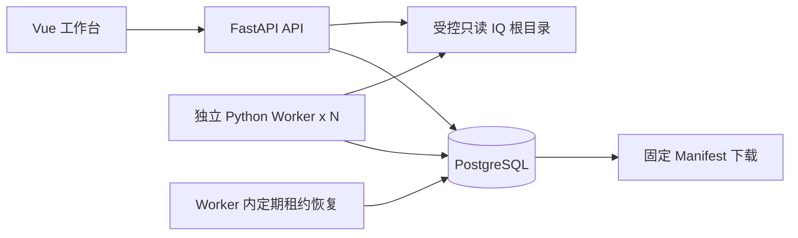

# 系统架构与技术决策

文档同时描述已实现部分与后续目标；五阶段核心范围已实现，最新交付见PHASE_5.md，历史记录见PHASE_1至4。
SCAN / SEGMENT / QUALITY / INFER / PUBLISH通过真实队列执行；登录、预测/人工分离、不可变快照和完整MVP工作台已实现。

## 组件与业务流程

后端是模块化单体，API 与 Worker 复用服务和 ORM，分别部署为独立进程。PostgreSQL 管业务
数据及持久化队列；磁盘只保存原始大文件。API 访问文件仅用于有界预览或校验，批量哈希/
推理/分段走 Worker。多个 Worker 必须共享文件路径语义，不得各自使用内容不一致的同名路径。

1. 管理员提交受控根目录扫描请求，API 创建幂等扫描任务并立即返回 202。
2. 扫描 Worker 检查完成标记和路径安全，分块 SHA-256，在短事务登记文件与配置。
3. 创建区间分段或质量任务；Worker 短事务领取后提交，在事务外校验源、计划区间或计算质量。
4. 提交事务同时验证执行令牌、写片段/结果、更新任务状态；唯一约束处理重试去重。
5. 推理任务保存模型预测，不写人工标签；为片段创建审核任务，低置信度排前。
6. 审核者以标签版本号提交，条件更新成功后同事务追加不可变标签历史。
7. 研究人员预览选择并提交PUBLISH，Worker在事务外完整校验；完成事务固定成员、标签、处理/模型版本及Manifest。
8. 之后的审核与处理只产生新记录/新数据集版本；旧 Manifest 字节不随当前数据变化。

## 模块边界

| 位置 | 职责 | 当前状态 |
|---|---|---|
| `app/api` | 参数、HTTP 状态、依赖注入；不进行长计算 | health、资产/预览、任务提交/查询/重发、登录、模型/预测/审核、数据集预览/发布/下载已实现 |
| `app/core` | 配置、后续身份与错误规范 | 配置已实现 |
| `app/db`、`app/models` | Engine、Session、类型、约束 | users、资产/配置/区间/观察、任务/请求/事件/质量、会话/模型/预测/审核历史、数据集/固定版本/成员已实现 |
| `app/services`（阶段二起） | 业务事务入口、路径/接入/队列/发布编排 | 安全路径、接入、区间索引、租约队列、质量、认证、审核CAS和封存发布已实现 |
| `app/repositories`（有重复 SQL 后引入） | 可复用查询；不得擅自 commit | 未实现 |
| `app/signal_processing`（阶段二起） | IQReader、处理配置、模型协议 | BIN/HDF5、预览、Mock及TorchScript适配合同已实现；真实权重未验证 |
| `app/workers`（阶段三起） | 执行循环、独立心跳、租约恢复 | 已实现，Compose 可运行多个进程 |
| `frontend` | 数据资产、审核、数据集三个视图 | 资产接入、片段/质量/预标注、审核、任务管理、数据集版本与下载已实现 |

不用为每个表机械创建 Repository/Service；业务复杂度出现后再拆分。接口 schemas 随业务 API 引入。

## 主要决策

| 决策 | 原因/问题 | 替代方案及限制 |
|---|---|---|
| 同步 SQLAlchemy + psycopg 3 | 事务代码直观；FastAPI `def` 路由在线程池运行 | 异步可提升 I/O 并发，但增加学习负担；Session 同样不能共享 |
| READ COMMITTED + 显式行锁/CAS | 为每个业务不变量选择锁或条件更新，避免全局 Serializable 重试 | 不能依赖先 SELECT 再无条件 UPDATE；发布独立用 REPEATABLE READ |
| PostgreSQL 17，Python 3.11+（容器 3.12） | 成熟基线，目标 SQL 功能足够；无需追逐最新主版本 | 镜像标签为可更新补丁线，严格发布需进一步固定镜像 digest |
| Alembic 独立迁移进程 | API 多副本启动不会争抢 DDL；迁移可审查/回退 | 不用运行时 `create_all()` 代替迁移 |
| App factory + lifespan | 无导入时数据库副作用，测试实例隔离，退出释放连接池 | API 启动与数据库可用性通过 readiness 分开 |
| 引用原文件 + 区间索引 | 避免海量片段副本，支持追溯 | 必须维护源数据完整性与留存 |
| PostgreSQL 队列 | 数据和任务提交可共用事务，避免跨系统双写 | 扫描领取不是公平队列；吞吐量有限、需要清理历史与监控 |
| Manifest 字节存 PostgreSQL | 样本与 JSON 同事务发布，下载无需重新生成 | JSON 体积增长受发布上限保护；大规模可迁移对象存储与 Outbox |
| 简单账号/三角色与数据库会话 | 密码PBKDF2随机盐；短期不透明令牌可撤销，审核人取认证身份 | 已取代静态管理员令牌；目前限本机演示，CLI属可信入口 |

## Session 生命周期与事务边界

Engine/Session 工厂每个进程一个；每个请求业务操作、领取、心跳或恢复批次单独 Session。
`with session_factory.begin() as session:` 自动提交，异常回滚并关闭。服务函数定义完整事务，
下层查询函数不得隐藏提交。普通只读 Session 用 context manager 关闭，自动回滚残留只读事务。
阶段一 readiness 直接短连接查询；没有写业务或“请求结束自动提交”的隐式行为。

- 文件散列和 IQ 计算在事务外执行，校验扫描前后 stat 不变；这仍依赖采集方完成后不再写入。
- 领取只锁待领取的一行，更新后立即提交；不得在持锁期间读取 IQ。
- 心跳由 Worker 独立线程或进程发起，使用独立 Session；CPU 推理不能阻塞续租。
- 完成提交与正式业务结果同事务，防止“任务成功但结果缺失”或“过期结果可见”。
- 阶段五PUBLISH先在Worker事务外完成完整文件校验，然后在 REPEATABLE READ 事务中读取固定审核版本和成员，
  验证当前源状态并插入完整快照。发生序列化失败重试整个发布。外部文件不能被 SQL 隔离级别锁定，
  发布后每次实际导出数据仍需完整校验；Manifest 下载只返回历史元信息。

## 接入完整性与路径防护

文件内容和“如何解释 IQ 字节”的元数据都参与资产身份。相同字节用不同采样率解释不能静默合并。
MVP 接入扫描对所有完成候选计算完整 SHA-256，重扫仍校验内容，优先保证变更检出；
大小/mtime 仅为观察信息，不作为跳过完整校验的依据。限制扫描目录以控制首次版本的 I/O 成本。
受控路径须 resolve 后验证位于根目录，拒绝绝对路径、`..`、符号链接逃逸；生产 Linux 进一步使用
目录 fd / `O_NOFOLLOW` 打开并用 `fstat` 验证，减少检查与打开之间的 TOCTOU。HDF5 外部链接/外部
存储同样拒绝。容器只读挂载保护服务端误写，不能保证采集端停止写入。

已登记文件变更：产生新修订，旧记录标记 STALE；不得改写旧记录的哈希、区间或解释参数。
旧快照仍存在且可下载，但读取受损源文件必须失败并报告。路径下文件变回旧内容时完整校验后可
重新激活对应修订，需记录观察事件；不可把 STALE 清理为“历史不存在”。

## 依赖与运维边界

依赖精确版本锁到 requirements.lock；暂含测试工具，后续拆运行/开发锁。PostgreSQL 用具名卷，
本机端口限制为 loopback；容器 API 非 root。示例只适合本地演示，外网部署再加入 TLS、独立
最小权限应用角色和备份策略。用户表尚无账号种子，不提交密码哈希或真实 IQ。

## 官方参考

- [SQLAlchemy Session 生命周期与每线程 Session](https://docs.sqlalchemy.org/en/20/orm/session_basics.html)
- [PostgreSQL 17 SELECT / SKIP LOCKED](https://www.postgresql.org/docs/17/sql-select.html)
- [FastAPI Docker 部署及 exec 形式启动](https://fastapi.tiangolo.com/deployment/docker/)
- [Alembic 迁移教程](https://alembic.sqlalchemy.org/en/latest/tutorial.html)
- [Compose 健康依赖与启动顺序](https://docs.docker.com/compose/how-tos/startup-order/)

## 运行与恢复

scripts/quickstart.py统一准备本机依赖和Compose；--demo通过实际HTTP验证两个版本及旧字节不变。
备份脚本直接传递pg_dump二进制，--verify在独立随机数据库恢复并检查schema/Manifest后清理。
原始IQ/模型/私有配置不包含在数据库备份内，仍需各自留存与恢复规划。
