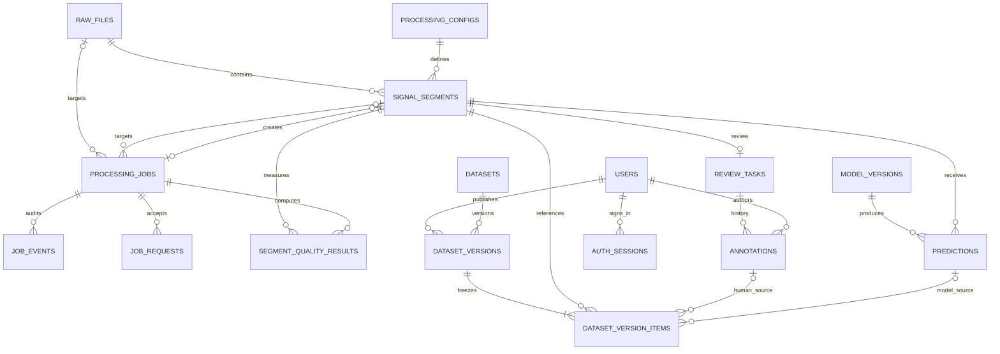

# 数据库 ER 与约束设计

**实施状态：当前head为0005_datasets，五阶段核心业务表均已实现。阶段五新增datasets、
dataset_versions、dataset_version_items，以及processing_jobs.dataset_id。不可变约束有真实SQL与并发测试。**
PostgreSQL public schema；UUID 主键由应用生成；时间用 timestamptz，
连接时区 UTC，API 返回带时区 ISO 8601。业务状态采用文本 + CHECK，避免 PostgreSQL Enum
修改带来的额外迁移操作。所有 FK 默认为 RESTRICT，不级联删除可追溯历史。

## ER 图（目标）



为避免歧义，`review_tasks` 同时持有当前人工标签版本号，`annotations` 是追加历史；
`processing_configs` 和 `job_events` 是对原始建议实体的补充，分别管理稳定处理身份和任务审计。
阶段二另加 `file_observations`，作为 raw_files 的一对多追加扫描历史，保留失效与重新激活事件。

## 阶段二实际约束

- raw_files 的完整身份唯一约束为 `uq_raw_identity`，部分唯一索引 `uq_raw_active_path`
  要求同一 root_key / relative_path 最多一个 ACTIVE 修订。
- stat_identity JSONB 保存 size/mtime/ctime/device/inode 字符串；跨环境预览只比较 size/mtime，
  一次读取内部比较完整本地 stat。它不是内容哈希替代品。
- processing_configs 的实际配置列名是 `parameters JSONB`，规范化后 SHA-256 为 config_hash。
- signal_segments 已有区间与配置身份唯一约束；阶段三增加 quality 缓存及来源任务外键。
  阶段二已有片段的 created_by_job_id 保持 NULL，不能伪造历史来源。
- file_observations 记录 REGISTERED / VERIFIED / CHANGED / REACTIVATED 及失效错误码。
- `protect_asset_history` 触发器保护源/片段身份不可改写，配置和观察历史不可修改/删除。
- `check_segment_source` 插入触发器验证源 ACTIVE、区间不越界、长度匹配窗口参数；
  样本边界用减法比较避免 bigint 加法溢出。服务端也做相同业务校验以返回友好的 4xx。

实际代码与 SQL 以 `models/assets.py` 和迁移 `0002_assets` 为准；接入事务与限制见 PHASE_2.md。

## 阶段三实际约束

- `processing_jobs` 实际列包含 root_key、target_identity、raw_file_id/segment_id、payload、
  dedupe_key/generation、parent_job_id、调度字段、result JSONB、result_digest、last_error 和时间。
  尚无 config_id、model_id、requested_by 外键；配置固定在 payload，用户归属留待认证阶段。
- 类型仅 SCAN / SEGMENT / QUALITY。SCAN 无目标外键；SEGMENT 必须仅有 raw_file_id；
  QUALITY 必须仅有 segment_id。CHECK 同时保证次数 0..max（max 1..10）、优先级 -100..100、
  RUNNING 必有 worker/lease，非 RUNNING 租约为空；仅 SUCCEEDED 存正式 result+digest。
- `uq_job_generation(dedupe_key,generation)` 固定逻辑任务及重发代次；领取/过期索引均以 root_key
  开头，后跟排序字段及部分状态条件。确切 SQL 见 TASK_SCHEDULER.md。
- `job_requests(request_key PK,request_hash,job_id FK,created_at)` 使多个请求可复用同一逻辑任务，
  同请求 key 异体冲突。请求编号全局唯一，不同 root 不能借同编号取得其他 root 的任务。
- `job_events` 实际列名为 event，detail 保存 origin 等审计信息；当前没有 actor_id。
- `segment_quality_results` 为不可变历史，UNIQUE(segment_id,algorithm_version)，保存 metrics、
  digest 及 created_by_job_id；signal_segments.quality 是当前基础指标缓存。
- `protect_job_contract` 禁止修改任务输入/调度策略与删除任务；终态不可更新；
  领取时 attempts/execution_version 必须恰好递增 1；RUNNING 更新不能更换 worker 或计数。
  `protect_segment_origin` 禁止改变已有来源任务。请求映射、事件、质量历史拒绝 UPDATE/DELETE。
- 原始业务表约束继续生效，正式结果与任务成功在同一 fenced 事务提交。
  直接持数据库管理权限者仍可禁用触发器，应用权限边界不等于防数据库管理员篡改。

实际 ORM 见 `models/jobs.py`，DDL 见迁移 `0003_jobs`。下面总表中的阶段四/五字段为目标设计。

## 已实现：users

| 列 | 定义 |
|---|---|
| id | UUID PK，应用 uuid4，无数据库扩展依赖 |
| username | varchar(64) NOT NULL UNIQUE；要求 lower(trim) 且 3–64 字符 |
| password_hash | varchar(255) NOT NULL；PBKDF2-HMAC-SHA256、随机盐、600000次迭代 |
| role | ADMIN / RESEARCHER / REVIEWER，数据库 CHECK |
| is_active | boolean NOT NULL DEFAULT true |
| created_at | timestamptz NOT NULL DEFAULT now() |

唯一索引覆盖用户名查找；无须再为 username 建相同普通索引。约束有确定命名，ORM 与迁移
对应；不会用 `Base.metadata.create_all()` 绕过迁移。阶段四CLI已实现用户名规范化和账号创建，
数据库 CHECK 保底，不允许大小写差异绕过唯一性。

## 当前实体与关键约束

阶段四实际调整和约束如下，阶段五的实际补充见下方发布约束：

- 模型表实际名为model_versions；predictions实际外键名为model_version_id。模型名称/版本唯一，
  adapter为mock/torchscript，定义、配置与权重哈希均禁止UPDATE/DELETE。
- processing_jobs新增INFER与model_version_id FK；仅INFER必须有模型外键且目标为segment；
  模型外键参与输入不可变保护，payload固定版本UUID，旧任务该外键保持NULL。
- predictions唯一(segment_id,model_version_id)，新增is_mock与语义digest；触发器验证来源INFER任务、
  模型/片段归属、Mock标识及分数归一化。预测历史不可改写或删除。
- review_tasks每片段唯一；v0必须PENDING且无人工作业指针；正版本必须有指针且为REVIEWED/UNKNOWN。
  更新只能递增一个版本，源片段身份不变，禁止删除。
- annotations保存版本、类别、动作、备注、登录reviewer_id与参考prediction_id。
  操作者必须为启用的ADMIN/REVIEWER，预测必须属同片段，CONFIRM需匹配预测。
- current_annotation_id为延迟外键：CAS先指定新UUID，同事务追加历史；提交时约束触发器校验
  指针、最新版本、任务归属和UNKNOWN状态。历史拒绝UPDATE/DELETE；不能绕过CAS单独追加下一版。
- auth_sessions以随机会话的SHA-256为PK，保存用户FK、expires_at与索引；不存访问令牌明文。
  login_buckets以规范用户名摘要为PK，保存60秒窗口与次数，事务锁保护跨进程限流。
  过期会话与旧窗口在登录时清理，尚无独立清理守护进程。
- 迁移0004在已有INFER任务时明确拒绝降级，避免悄悄丢弃新任务语义；往返测试使用隔离新库。

实际列以models/labeling.py和迁移0004为准。

| 实体 / 阶段 | 主要列 | 约束、索引与不变量 |
|---|---|---|
| raw_files / 二 | id, root_key, relative_path, sha256, metadata_hash, byte_size, mtime_ns, format, iq_metadata JSONB, sample_count, status, created_at | UNIQUE(root_key,relative_path,sha256,metadata_hash)；CHECK size>0, samples>0；索引(root_key,relative_path)、sha256；ACTIVE/STALE/INVALID；哈希/解释元数据不可覆盖 |
| processing_configs / 二 | id, config_hash, canonical_json, reader_version, pipeline_version, created_at | UNIQUE(config_hash)；规范 JSON 固定窗口、步长、预处理与算法版本，实际参数必须保留 |
| signal_segments / 二、三 | id, raw_file_id FK, config_id FK, start_sample bigint, sample_count integer, quality JSONB, created_by_job_id FK, created_at | UNIQUE(raw_file_id,config_id,start_sample,sample_count)；CHECK start>=0,count>0；跨表边界在同一验证事务检查 start+count<=raw.sample_count；按 raw_file_id 查询索引 |
| processing_jobs / 三 | id, root_key, job_type, target_identity, raw_file_id? FK, segment_id? FK, model_version_id? FK, dataset_id? FK, payload JSONB, dedupe_key, generation, parent_job_id? FK, status, priority, attempts, max_attempts, worker_id, execution_version, lease_until, next_run_at, result JSONB, result_digest, last_error, created_at, updated_at | UNIQUE(dedupe_key,generation)；类型/目标/租约/结果 CHECK；输入及终态不可改；索引见队列文档 |
| job_requests / 三 | request_key PK, request_hash, job_id FK, created_at | 请求到逻辑任务的多对一追加映射 |
| job_events / 三 | id, job_id FK, event, worker_id?, execution_version, detail JSONB, created_at | 追加事件，索引(job_id,created_at,id)；记录领取、过期、重试、失败、成功和手工重发 |
| segment_quality_results / 三 | id, segment_id FK, algorithm_version, metrics JSONB, digest, created_by_job_id FK, created_at | UNIQUE(segment_id,algorithm_version)；不可变质量历史 |
| model_versions / 四 | id, name, version, adapter, artifact_sha256?, config JSONB, created_at | UNIQUE(name,version)；模型定义不可变；Mock 明确 adapter=mock，不伪造权重哈希 |
| predictions / 四 | id, segment_id FK, model_version_id FK, label, scores JSONB, confidence, inference_ms, is_mock, digest, created_by_job_id FK, created_at | UNIQUE(segment_id,model_version_id)；CHECK confidence∈[0,1]；模型含预处理版本，不覆盖旧预测 |
| review_tasks / 四 | id, segment_id FK UNIQUE, status, label_version DEFAULT 0, current_annotation_id? FK, created_at, updated_at | 索引(status,updated_at,id)；UNKNOWN 与未审核分开；版本只能经 CAS 增加；提交时验证 annotation 属于相同 task |
| annotations / 四 | id, review_task_id FK, version, label, reviewer_id FK, action, comment, prediction_id? FK, created_at | UNIQUE(review_task_id,version)，version>0；数据库触发器禁止 UPDATE/DELETE；操作者来自认证上下文 |
| datasets / 五 | id, root_key, name, description, created_by FK, created_at | UNIQUE(root_key,name)；MVP定义禁止UPDATE/DELETE，当前根隔离 |
| dataset_versions / 五 | id, dataset_id FK, version, selection JSONB, label_policy, model_version_id? FK, allow_mock_predictions, published_by FK, publish_job_id FK, created_at, creation_xid, sealed, item_count, manifest_text TEXT, manifest_sha256 | UNIQUE(dataset_id,version)、UNIQUE(publish_job_id)；限10000成员/16MiB；创建事务内一次封存，提交时必须sealed |
| dataset_version_items / 五 | id, dataset_version_id FK, segment_id FK, raw_file_id FK, annotation_id? FK, prediction_id? FK, label_source, frozen_label, snapshot JSONB | UNIQUE(dataset_version_id,segment_id)；HUMAN仅annotation、MODEL仅prediction；snapshot由DB验证生成；封存后拒绝INSERT/UPDATE/DELETE |

`created_by_job_id` 已在阶段三为片段表补迁移，避免循环建表依赖。SCAN 任务无
raw/segment FK，root_key 从服务端配置取得；SEGMENT 对应 raw FK，QUALITY 对应 segment FK。
`target_identity` 保存稳定的目标字符串及区间，不用它替代可用的 FK。

## 标签并发控制（阶段四）

API 收到 `expected_version` 后，用条件更新抢占版本：

```sql
UPDATE review_tasks
SET label_version = label_version + 1, updated_at = clock_timestamp()
WHERE id = :task_id AND label_version = :expected_version
RETURNING label_version;
```

同一事务插入新 annotation，更新 current_annotation_id 与审核状态。返回零行时回滚：
不存在返回 404，版本冲突返回 409；禁止在冲突后自动用新版本覆盖。插入失败时 CAS 也会回滚。
没有人工确认时不创建“预测等同人工”的 annotation。标签历史和当前指针要么一起提交，要么一起回滚。

## 发布不可变快照（阶段五已实现）

发布是PUBLISH后台任务：完整源文件校验在Worker事务外执行，提交阶段在REPEATABLE READ重新筛选，
核对预览selection_digest；固定具体人工/模型记录，不拼接动态当前标签。作业携带dataset_id外键及
publisher_id，模型来源策略在payload中固定，并落入版本表外键/字段。发布者必须仍为有效ADMIN/RESEARCHER。

同事务插入版本及成员，读取rf_dataset_manifest生成的固定JSONB，再规范编码为UTF-8文本与SHA-256，
封存并更新任务成功；最后执行令牌/租约检查失败会整体回滚。原始大文件不写入数据库。

- creation_xid由pg_current_xact_id记录；新版本只能在该事务内从unsealed一次性转为sealed。
- rf_guard_dataset_item在INSERT时锁父版本，拒绝封存/跨事务追加，检查root、ACTIVE、标签来源和
  人工优先规则，检查成员满足冻结的筛选条件，并从不可变引用构造snapshot。
- snapshot合并存储source、interval、processing、annotation、prediction等冻结结构，取代早期设计中
  多个frozen_* JSON列；身份外键与frozen_label仍保留，便于约束和统计。
- rf_guard_dataset_version验证数量、16MiB上限、Manifest实际UTF-8字节SHA-256，以及解析后的内容
  是否精确等于固定成员生成的清单。无额外pgcrypto扩展。
- 延迟约束rf_require_sealed_version在提交时拒绝未封存版本；版本UPDATE/DELETE与封存后成员
  INSERT/UPDATE/DELETE均被数据库拒绝。并发插入会争同一父行锁。
- 两个发布者争同名版本由uq_dataset_version裁决，只有一个正式版本；失败不留部分成员。
- 已有PUBLISH历史时拒绝降级到阶段四；已有INFER历史时阶段四也拒绝继续降级，需明确的归档规划。

清单下载只返回首次存储的manifest_text字节；列表统计也只查询固定成员。源文件失踪或人工标签
随后变化不会改变历史元信息。大型磁盘导出包仍未实现，实际导出IQ需再次按快照完整哈希校验。
数据库管理员可以主动禁用触发器，应用约束不构成防管理员篡改的安全边界。

实际实现：models/datasets.py、services/datasets.py、迁移0005_datasets与alembic/sql/0005_snapshots.sql。
源码、事务解释、已验证上限与测试见PHASE_5.md和TESTING.md。
