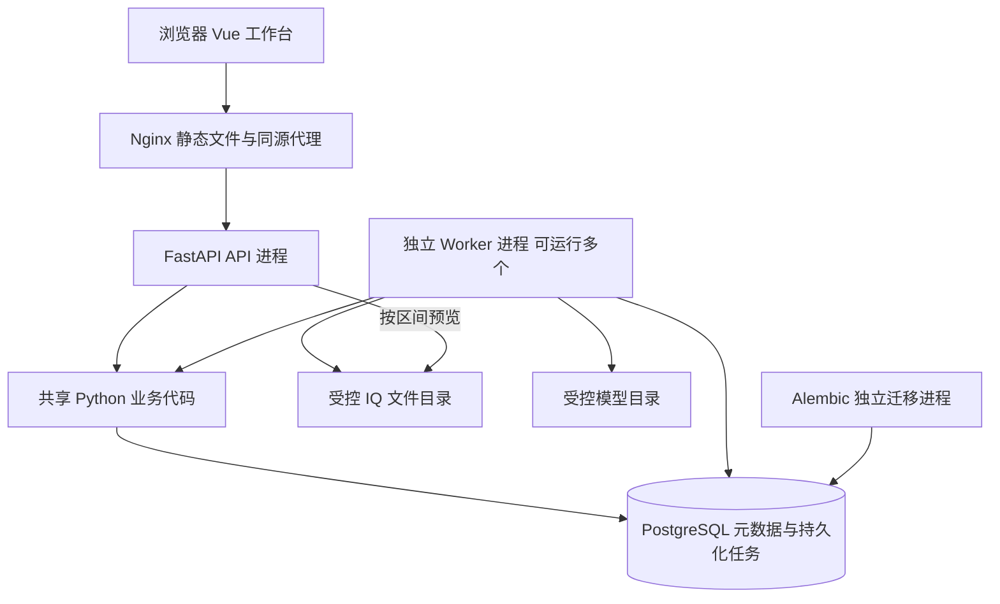
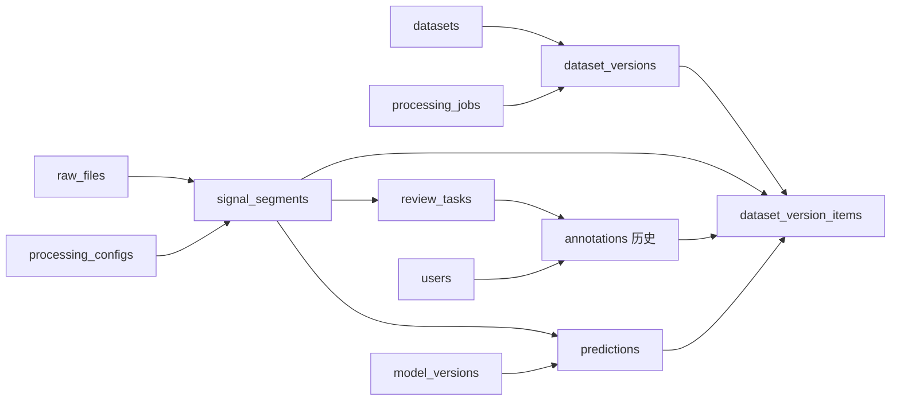

# RF-DataOps：基于真实源码的项目知识地图

审查日期：2026-10-26（北京时间）。范围：当前工作区源码，不等同于某个 Git 提交或正在运行的容器镜像。

本轮只审查源码、配置、迁移和测试，收集测试用例，新增学习文档；未启动/重建服务、运行迁移、提交任务、修改业务数据或核心代码。后续阅读顺序见 [学习路线][roadmap]，掌握情况见 [学习记录][progress]。

## 1. 证据标准

- **已实现**：存在可追踪的入口、业务处理、数据写入/返回；不自动等于所有环境已通过测试。
- **部分实现**：只有子集、适配接口或运维脚本，距离完整能力仍有明确缺口。
- **未实现**：本轮审查范围未找到可执行实现；文档里出现需求或计划不算实现。
- **尚未验证**：有代码或历史记录，但缺少本轮或对应场景的验证。它可以与“已实现/部分实现”同时成立。

下文技术选择的理由，是根据代码与当前需求做出的架构解释。除非另有记录，不把它说成开发时真实发生过的团队决策、故障或性能实验。

## 2. 业务背景与范围

项目解决的是信号数据的整理、处理和标签追溯问题：原文件在哪里、应该怎样解释、某个片段来自哪一段采样、哪个模型给过建议、谁确认了标签、某次实验使用的是哪个固定版本。

当前定位是本地科研数据治理与软件工程学习的 MVP。原始 IQ 放在受控文件目录，数据库主要保存身份、区间、处理记录、标签和版本清单。它没有提供模型训练、任意文件上传、实时流处理或完整生产运维能力。

角色入口见 [鉴权依赖][auth-api]：ADMIN 可提交常规处理并审核、发布；REVIEWER 可审核；RESEARCHER 可创建/发布数据集。业务读取需要登录；健康接口与 OpenAPI 公开。用户和模型定义是全局表，`root_key` 是受控存储根的逻辑范围，不能称为完整的多租户隔离。

## 3. 整体架构

这是**模块化单体 + 独立后台 Worker**：API/Worker 使用同一个后端镜像和业务模块、同一个数据库；进程分离不意味着拆成微服务。证据是 [Compose][compose] 的共享 `x-backend`、[Worker][worker] 对 `services` 的调用，以及 [应用工厂][main] 的路由注册。

业务接口是同步 `def`，SQLAlchemy 使用同步 Engine/Session 和 psycopg。异步生命周期和异常处理函数确实存在，但未使用 AsyncSession、异步数据库驱动或 asyncio 任务队列。本机安装的 FastAPI `run_endpoint_function` 源码也确认同步入口经线程池调度；这不等于 CPU 密集任务自动获得高吞吐。

后台 Worker 每个进程主要串行处理一个任务，额外启动 `LeaseGuard` 维护线程进行心跳/恢复；多个 Worker 形成并发。HTTP 的 `202` 表示任务已接收，处理进度由页面轮询数据库记录，不使用 WebSocket。

## 4. 技术栈、为什么选它，以及代价

| 技术与实际用法 | 可以从需求解释的理由 | 代价、替代方案或不能夸大的地方 | 代码证据 |
|---|---|---|---|
| FastAPI + Pydantic：接口、依赖、参数和返回模型 | 请求合同明确，便于调试和生成 OpenAPI | 不能把同步阻塞 I/O 改写成 `async def` 就宣称异步；Django/Flask 也可实现业务 | [main][main]、[jobs API][jobs-api]、[schemas][job-schema] |
| SQLAlchemy 2 同步 ORM/Core 混用 | 普通 CRUD 与 SQL 条件更新/CTE 都能表达，事务由业务层组织 | ORM 不替代 SQL、索引和锁知识；数据库特有 SQL 降低可移植性 | [Session 工厂][db]、[队列][queue] |
| PostgreSQL：关系表、JSONB、约束、锁和任务队列 | 当前规模可共用一个事务资源，结果和任务成功一起提交 | 业务查询和队列共享数据库资源；无大规模吞吐证据。更复杂场景可评估专用消息系统，不能假定它天然解决双写 | [模型][job-model]、[队列][queue]、[封存 SQL][snapshot-sql] |
| Alembic 独立迁移 | 显式控制数据库结构变化，服务就绪检查可核对版本 | 当前只有单线迁移，没有自动处理分支迁移冲突；降级不是任意删历史的工具 | [迁移环境][migration-env]、[health][health] |
| 本地文件目录 + NumPy/h5py | 复用通信领域的 IQ 与数组处理；片段只保留区间 | 依赖采集侧完成后不可改写；没有对象存储、物理归档或任意 HDF5 自动识别 | [存储][storage]、[读取器][readers]、[预览计算][preview] |
| Vue 3 + Element Plus + ECharts + Axios | 表单、表格、波形、频谱和 HTTP 交互集中在轻量工作台 | `App.vue` 同时管理登录、审核和预测，后续可按职责继续拆分；无 Vue Router/集中状态库 | [App.vue][app-vue]、[前端依赖][frontend-package] |
| Docker Compose + Nginx | 把数据库、迁移、API、Worker、前端放在同一套可启动环境中 | 这是本地编排，不提供数据库高可用、跨主机调度或完整公网安全 | [Compose][compose]、[Nginx][nginx] |
| pytest + Playwright | 纯计算检查、真实 PostgreSQL 约束/并发测试与浏览器链路互补 | 测试通过不等于容量和长稳验证；浏览器测试会写开发演示记录 | [测试夹具][fixtures]、[浏览器测试][browser-publish] |

当前依赖范围以 `backend/pyproject.toml` / `frontend/package.json` 为准，精确安装版本以锁文件为准。不能用技术名称替代对应调用机制的解释。

## 5. 模块职责与依赖方向

| 模块 | 职责 | 关键符号 | 主要依赖 |
|---|---|---|---|
| 启动/配置/连接 | 构造应用、管理引擎生命周期、读取配置、检查就绪 | `create_app`、`Settings`、`build_engine`、`build_session_factory`、`ready` | [main][main]、[config][config]、[db][db]、[health][health] |
| HTTP 层 | 校验输入、鉴权、取请求范围、调用业务、返回状态 | `create_job`、`annotation`、`publish`、`get_session` | [jobs API][jobs-api]、[审核 API][label-api]、[数据集 API][dataset-api]、[资产 API][assets-api] |
| 登录/角色 | 密码校验、不透明会话、账号级限流、权限检查 | `login`、`issue_session`、`current_user`、`require_*` | [认证服务][authentication]、[鉴权依赖][auth-api] |
| 文件/区间 | 完成协议、路径防护、哈希身份、修订和分段索引 | `ControlledRoot`、`inspect_file`、`register_in_session`、`prepare_segments`、`persist_segments` | [storage][storage]、[ingestion][ingestion]、[segments][segments]、[readers][readers] |
| 任务调度 | 请求幂等、逻辑任务去重、领取、续租、完成、失败与恢复 | `JobQueue`、`ExecutionToken`、`PreparedWork` | [queue][queue]、[job_work][work] |
| 后台执行 | 调用准备/提交、心跳线程、轮询和进程退出 | `Worker.run_once`、`LeaseGuard`、`main` | [runner][worker] |
| 预测/人工结论 | 适配模型、持久化预测、创建审核任务、追加人工历史 | `MockModel`、`TorchScriptModel`、`ensure_review`、`annotate` | [模型适配][adapters]、[审核服务][label-service] |
| 数据集发布 | 筛选、预览摘要、完整源校验、固定成员与清单封存 | `select_members`、`prepare_publication`、`apply_publication`、`rf_guard_dataset_*` | [发布服务][dataset-service]、[封存 SQL][snapshot-sql] |
| CLI/辅助脚本 | 可信本机管理、演示、备份、小批量转换 | CLI `main`、`quickstart`、`backup`、`prepare_hetrf_demo` | [CLI][cli]、[admin][admin]、[脚本][hetrf] |

典型方向是 API → service → ORM/SQL/文件读取。模型定义不发起 HTTP。前端传 ID/参数，通过 API 访问，不直接连接数据库。现有代码在少量函数中局部导入其他服务以处理依赖环，不能宣称已经实现严格、完全解耦的领域架构。

## 6. 数据库地图：18 张 ORM 业务表

`alembic_version` 是迁移工具表，不包含在下面 18 张业务表中。关系主要通过真实外键和显式 join 表达，不依赖大量 ORM `relationship()`。

| 表 | 关键字段 | 关系与职责 | 定义 |
|---|---|---|---|
| users | `id, username, password_hash, role, is_active` | 用户身份；被会话、人工记录、数据集创建/发布引用 | [User][user-model] |
| auth_sessions | `token_hash, user_id, expires_at` | 多个会话属于一个用户；只存令牌摘要 | [AuthSession][label-model] |
| login_buckets | `key, window_start, attempts` | 规范用户名对应的限流桶，不是 IP 全局限流 | [LoginBucket][label-model] |
| raw_files | `root_key, relative_path, sha256, metadata_hash, sample_count, status` | 每个文件修订的不可变身份；状态/观察信息可变化 | [RawFile][asset-model] |
| file_observations | `raw_file_id, event, created_at` | 一个源修订对应多条追加接入观察 | [FileObservation][asset-model] |
| processing_configs | `config_hash, parameters, reader_version, pipeline_version` | 固定分段规则，多片段可共享配置 | [ProcessingConfig][asset-model] |
| signal_segments | `raw_file_id, config_id, start_sample, sample_count, created_by_job_id` | 文件里的采样区间；`quality` 为质量摘要 | [SignalSegment][asset-model] |
| processing_jobs | `job_type, payload, dedupe_key, generation, status, attempts, worker_id, execution_version, lease_until` | 五类任务统一调度；不同类型有相应目标外键 | [ProcessingJob][job-model] |
| job_requests | `request_key, request_hash, job_id` | 多个请求键可映射到一个逻辑任务 | [JobRequest][job-model] |
| job_events | `job_id, event, worker_id, execution_version, detail` | 每个任务的追加事件历史 | [JobEvent][job-model] |
| segment_quality_results | `segment_id, algorithm_version, metrics, digest, created_by_job_id` | 片段与算法版本唯一的质量结果 | [SegmentQuality][job-model] |
| model_versions | `name, version, adapter, config, artifact_sha256` | 固定模型定义，支持 mock/torchscript | [ModelVersion][label-model] |
| predictions | `segment_id, model_version_id, label, scores, is_mock, digest` | 片段与模型版本唯一；不等同人工结论 | [Prediction][label-model] |
| review_tasks | `segment_id, status, label_version, current_annotation_id` | 每片段最多一条审核状态，指向当前人工历史 | [ReviewTask][label-model] |
| annotations | `review_task_id, version, label, action, reviewer_id, prediction_id` | 一次人工提交一条历史，可引用模型建议 | [Annotation][label-model] |
| datasets | `root_key, name, description, created_by` | 版本的组织容器；本版没有编辑/删除功能 | [Dataset][dataset-model] |
| dataset_versions | `dataset_id, version, selection, publish_job_id, sealed, manifest_text, manifest_sha256` | 发布时固定版本，`creation_xid` 限制在同一创建事务封存 | [DatasetVersion][dataset-model] |
| dataset_version_items | `dataset_version_id, segment_id, annotation_id/prediction_id, frozen_label, snapshot` | 固定成员和来源；人工或模型来源二选一 | [DatasetVersionItem][dataset-model] |

箭头表示关联方向概览，省略辅助表与部分反向外键。重要的不变量：每路径最多一个 ACTIVE 修订；片段身份唯一；每片段/模型版本最多一份预测；人工历史 `(review_task_id, version)` 唯一；每数据集版本名唯一；封存后禁止改/删/追加成员。

这些保证分布在 ORM 声明与 Alembic 的数据库触发器中，不能只读 models 就以为看完了完整约束。重点迁移是 `0002_assets`、`0003_jobs`、`0004_labeling`、`0005_datasets`，封存细节另在 [SQL 文件][snapshot-sql]。

## 7. 主业务链：这里是导航，不展开单行源码教学

### 7.1 提交与执行是两条链

网页 `AssetCenter.enqueue` → `POST /api/v1/jobs`（扫描也有 `/scans`）→ `create_job` → `JobQueue.submit` → 写 `processing_jobs/job_requests/job_events` → 返回 `202 + job_id`。

另一个进程运行 `Worker.run_once` → `recover` → `claim` → `prepare_work` → `complete` → `apply_work` → 最后校验执行身份与租约，提交业务结果和 SUCCEEDED。页面轮询 `GET /jobs/{id}`。

来源：[资产页面][asset-vue]、[jobs API][jobs-api]、[queue][queue]、[runner][worker]、[job_work][work]。CLI 同样调用 `JobQueue.submit`，不是同步完成整项工作。

### 7.2 五类后台任务

| 类型 | 准备阶段，正式写入事务外 | 完成事务写入 | 重要异常 |
|---|---|---|---|
| SCAN | `ControlledRoot.candidates` → `inspect_file`，形成 `ScanPlan` | `register_in_session` / `invalidate_in_session`，登记修订与观察 | 无 `.done` 计 skipped；格式等错误放 `result.errors`；单次最多 100 个路径 |
| SEGMENT | `prepare_segments`，完整校验源，计算有界区间计划 | `persist_segments` 写固定配置和片段引用 | 源失效、内容变化、区间越界、超过 1,000 窗口 |
| QUALITY | 区间读取 → `build_preview` 的统计，形成 `QualityPlan` | 写质量结果，并更新片段摘要 | NaN/Inf 拒绝；没有质量评分阈值拦截后续处理 |
| INFER | 完整校验源 → 区间读取 → `adapter_for(...).predict` | 写预测并 `ensure_review`，不追加人工历史 | 输入长度/预处理不符、运行时缺失、同模型结果冲突 |
| PUBLISH | `prepare_publication` 核对选择摘要并完整校验源 | `apply_publication` 固定成员、生成文本/哈希、封存 | 选择变化、源变化、版本重名、过期执行 |

**不要把旧的 `IngestionService.scan` 当作网页调用链。** 它是仍供可信服务/测试使用的同步路径，可逐文件事务写入；当前网页/CLI 的 SCAN 通过 `prepare_work/apply_work`，有效文件登记和任务成功处在同一个完成事务。这两个入口的事务组织不同。`index_segments` 也保留了同步可信入口。

### 7.3 人工审核是同步业务事务

`App.vue.save` → `POST /reviews/{id}/annotations` → `require_reviewer` → `annotate` → 按 `expected_version` 条件更新审核状态 → 插入 `annotations` → 一起提交。冲突返回 `409`，前端保留草稿。它不经过 Worker，也不会覆盖 `predictions`。

来源：[审核 API][label-api]、[annotate][label-service]、[App.vue][app-vue]。

### 7.4 固定版本与下载

创建 dataset → `selection-preview` 返回数量/分布和 `selection_digest` → 携带期望摘要提交 PUBLISH → Worker 完成封存 → `GET /dataset-versions/{id}/manifest` 返回数据库保存的原字节 → 浏览器计算 SHA-256 校验后下载。

默认 HUMAN_ONLY + REVIEWED；MODEL_ALLOWED 必须指定模型，已有人工记录始终优先，UNKNOWN 也属于人工记录；直接采用 Mock 预测需要明确许可。Manifest 没有打包原始 IQ，冻结引用不会让物理源文件自动不可变。

来源：[数据集 API][dataset-api]、[发布服务][dataset-service]、[封存 SQL][snapshot-sql]、[数据集页面][dataset-vue]。

## 8. 实现状态与验证状态

| 能力 | 实现状态 | 验证边界 |
|---|---|---|
| 显式 BIN/HDF5 接入、区间预览与修订 | 已实现 | 有读取器/接入测试；格式受限，不推断任意实验室布局 |
| SCAN/SEGMENT/QUALITY/INFER/PUBLISH 队列 | 已实现 | 有并发、故障、回滚和重放测试；无生产吞吐证据 |
| 登录、三角色、退出、账号级限流 | 已实现 | 有认证/权限测试；不是 JWT、SSO 或完整互联网安全体系 |
| Mock 模型建议 | 已实现 | 有确定性和归一化测试；分数不是准确率 |
| TorchScript 推理接入 | 部分实现，真实效果尚未验证 | 有 CPU 适配、可信权重校验和 CLI 注册；测试覆盖输入不符/缺运行时，未证明真实权重成功推理 |
| 单标签人工审核、历史与冲突保护 | 已实现 | 有并发 201/409、回滚与数据库约束测试 |
| 固定数据集与 Manifest | 已实现 | 有版本隔离、源哈希、并发与 SQL 防篡改测试；不提供 IQ 物理归档 |
| 资产/任务/审核/数据集网页 | 已实现 | 有两个浏览器测试；本轮没有再次启动浏览器执行 |
| HetRF-Mix 接入 | 部分实现 | [转换脚本][hetrf] 每 split 最多 50 条转独立 BIN，来源 JSON 保留多标签；原三维 HDF5 直读和 26 类多标签审核未实现 |
| 数据库备份/隔离恢复验证 | 已实现脚本 | 历史交付有演练记录；不包含 IQ、模型、`.env`，不是全环境灾备 |
| 自动目录监控、网页上传、标签批量导入、模型训练 | 未实现 | 当前只有手动扫描/受控目录和固定单标签工作流 |
| asyncio 数据库、Redis/Celery、微服务、任务 DAG/自动串联、取消抢占 | 未实现 | QUALITY 是独立任务；后续业务没有强制等待质量合格的检查 |
| CI 流水线、指标告警、全链路追踪、高可用 | 本轮未找到实现 | 有日志/任务事件/健康检查，但不能扩大为完整可观测性平台 |
| 满容量、长稳、公网安全、真实识别精度 | 尚未验证 | 不提供 QPS、加速倍数、准确率等数字 |

## 9. 核心难点：问题、保护及证据

| 如果不做保护会怎样 | 当前设计 | 关键证据与可复习测试 |
|---|---|---|
| 重复点击不断新增相同任务 | 请求键+请求摘要；逻辑任务摘要；数据库事务级 advisory lock | `JobQueue._request/submit`；`test_full_worker_quality_and_idempotent_requests` |
| 两个 Worker 同时拿到一个待执行任务 | CTE + `FOR UPDATE SKIP LOCKED` + 条件 UPDATE，在短事务领取 | `JobQueue.claim`；`test_two_processes_claim_only_one_job` |
| 工作进程崩溃，任务永远 RUNNING | 租约、心跳、过期扫描与有限重试 | `LeaseGuard`、`heartbeat/recover`；`test_killed_worker_recovers_and_old_execution_cannot_publish` |
| 旧 Worker 恢复后覆盖新结果 | job/worker/execution_version/有效租约共同校验；最终成功更新前再校验 | `_conditions/complete`；`test_final_lease_fence_rolls_back_already_inserted_rows` |
| 业务行写到一半却显示成功，或结果有了而任务未成功 | `complete` 的同一个数据库事务写结果、最终状态、事件；异常回滚 | `test_result_transaction_rolls_back_all_business_rows`、`test_inference_and_annotation_partial_writes_roll_back` |
| 两个人互相覆盖审核结论 | `expected_version` 条件更新，失败返回 409；历史追加 | `annotate`；`test_two_reviewers_conflict_then_append_history` |
| 新模型或新标签改掉旧实验版本 | 模型/预测/人工历史不可变；版本保存固定来源与原 Manifest 字节 | `rf_guard_dataset_*`；`test_new_label_and_new_version_leave_old_manifest_unchanged` |
| 发布时混入不同时间的人工标签 | 完成事务用 REPEATABLE READ；事务内重新核对选择摘要 | `JobQueue.complete`、`apply_publication`；`test_repeatable_read_keeps_one_label_snapshot_during_concurrent_review` |
| 大文件检查长期占着数据库事务 | 哈希与计算放在 prepare；完成阶段只做快速复核与正式写入 | `inspect_file/prepare_work/complete`；“较短”不等于有生产时延保证 |
| 路径逃逸或 HDF5 外链读到目录外 | 规范相对路径、拒绝链接、Linux 安全打开、HDF5 hard-link 限制 | `ControlledRoot/Hdf5Reader`；`test_reject_symlink_escape`、`test_hdf5_rejects_unsafe_or_unsupported_storage` |

重试允许重复执行和计算，受保护的是正式逻辑结果；不能称为严格 exactly-once。测试中的强杀、延迟和故障注入发生在隔离环境，不能说成用户生产环境真实事故。

## 10. 静态审查发现的风险与待验证问题

以下用于后续学习和验证，本轮不自动修核心代码。

1. **文件系统与数据库没有统一事务。** 完整哈希之后仍依赖源不可改写；预览只检查大小/mtime/解释信息及读取期间身份。只读挂载也不能阻止宿主机改写。见 `inspect_file/verify_observation` 和 [preview API][assets-api]。
2. **每次 QUALITY/INFER 都会完整校验源。** 多片段来自大文件时会反复读同一源，真实性能待测；不能因为返回小数组就称为小 I/O。HDF5 压缩块也会放大读取。见 [job_work][work]、[readers][readers]。
3. **连接池与后台规模有关联。** 每个进程池 `5 + 5`，并非全系统只有 5 条连接；线程池与心跳使用独立 Session，扩进程需要同时评估数据库连接上限。见 [db][db]、[runner][worker]。
4. **错误分类存在待补验证的缺口。** `main` 对 OperationalError 返回 503，尚无对连接池 `sqlalchemy.exc.TimeoutError` 的专门处理；池耗尽场景可能走一般 500。此项是静态风险，尚未执行故障实验确认。见 [main][main]、[db][db]。
5. **列表可能逐条补查。** `review_out` 查询当前 annotation，`version_out` 对每个版本计算分布；分页有界，但 SQL 次数/性能仍需实际测量，不能凭代码给出精确压测数字。见 [审核 API][label-api]、[数据集 API][dataset-api]。
6. **安全边界是本地可信环境。** Compose 没有拆分迁移/应用最小权限数据库账号；CLI 持有数据库凭据，不能当作公开服务。密码找回、IP 限流、MFA、TLS 配置未实现。
7. **日志和事件不等于完整监控。** 已记录 job_id/worker_id/execution_version、脱敏错误和数据库事件；没有指标平台、请求追踪关联或告警规则。
8. **脚本不是完整导入产品。** HetRF 小样本转换不写人工标签，测试频率/IQ通道解释需要来源确认；转换失败可能留下未完成输出目录，不提供自动恢复/全量导入。
9. **构建一致性与容量仍有边界。** 应用代码复制进镜像，源码改动不会自动刷新容器；基础镜像标签未固定 digest。封存触发器和逐成员写入有成本，10,000 成员上限不是测得的吞吐结论。
10. **旧文档/注释有历史残留。** `REQUIREMENTS.md` 仍有“模型和标签仍未实现”，`User` docstring 仍描述阶段四才引入认证；当前真实认证/标注入口已经存在。以当前调用链和迁移为准，不按该句否认实现。

## 11. 本轮验证与历史证据分开记录

本轮执行 `python scripts/dev.py test --collect-only -q`，成功收集：config 3、database 5、datasets 22、health 2、ingestion 15、readers 34、jobs 20、labeling 11，共 **112 个用例**。收集不运行测试体/数据库 fixture，不能报告为 112 项通过。本轮观察到 TestClient 的 Starlette 弃用警告。

本轮还读取了旧 JUnit：`artifacts/pytest-phase5-local.xml` 的时间为 2026-10-20，112 个测试、0 failures、0 errors、2 skipped，即 110 通过/2 跳过。Linux 112 通过、两个浏览器流程通过、备份恢复等属于 [历史交付记录][testing]，本轮未重新执行，不把记录当作今天的运行状态。

复查第 9 节证据时，优先打开 [任务并发/故障测试][jobs-test]、[审核与认证测试][label-test]、[数据集发布测试][dataset-test]；文件/区间规则另见 [读取器测试][reader-test] 和 [接入测试][ingestion-test]。浏览器冲突保护在 [双会话审核测试][browser-review]，版本不变与下载在 [发布测试][browser-publish]。

测试安全入口：[postgres_database fixture][fixtures] 检查 `RF_TEST_DATABASE_NAME` 前缀，创建随机独立数据库并在退出后清理；浏览器测试不同，会向开发服务写独立合成记录。后续实验优先纯测试或隔离库，未经用户要求不重跑会写业务记录的浏览器演示。

## 12. 推荐的第一站

先学习 M0“整体架构与一次任务的双调用链”：只理解点击提交后 HTTP 做什么、Worker 做什么、结果在哪里，不立即解释锁的全部细节。完成业务理解、源码定位、小实验与口述追问后，才能标记基本掌握。

[roadmap]: C:/Users/39675/.codex/.chatgpt-projects/g-p-6ab891bbc5488191b50279f531d676f2/rf-dataops/docs/LEARNING_ROADMAP.md
[progress]: C:/Users/39675/.codex/.chatgpt-projects/g-p-6ab891bbc5488191b50279f531d676f2/rf-dataops/docs/LEARNING_PROGRESS.md
[main]: C:/Users/39675/.codex/.chatgpt-projects/g-p-6ab891bbc5488191b50279f531d676f2/rf-dataops/backend/app/main.py
[config]: C:/Users/39675/.codex/.chatgpt-projects/g-p-6ab891bbc5488191b50279f531d676f2/rf-dataops/backend/app/core/config.py
[db]: C:/Users/39675/.codex/.chatgpt-projects/g-p-6ab891bbc5488191b50279f531d676f2/rf-dataops/backend/app/db/session.py
[compose]: C:/Users/39675/.codex/.chatgpt-projects/g-p-6ab891bbc5488191b50279f531d676f2/rf-dataops/docker-compose.yml
[health]: C:/Users/39675/.codex/.chatgpt-projects/g-p-6ab891bbc5488191b50279f531d676f2/rf-dataops/backend/app/api/health.py
[job-schema]: C:/Users/39675/.codex/.chatgpt-projects/g-p-6ab891bbc5488191b50279f531d676f2/rf-dataops/backend/app/schemas/jobs.py
[migration-env]: C:/Users/39675/.codex/.chatgpt-projects/g-p-6ab891bbc5488191b50279f531d676f2/rf-dataops/backend/alembic/env.py
[frontend-package]: C:/Users/39675/.codex/.chatgpt-projects/g-p-6ab891bbc5488191b50279f531d676f2/rf-dataops/frontend/package.json
[nginx]: C:/Users/39675/.codex/.chatgpt-projects/g-p-6ab891bbc5488191b50279f531d676f2/rf-dataops/frontend/nginx.conf
[auth-api]: C:/Users/39675/.codex/.chatgpt-projects/g-p-6ab891bbc5488191b50279f531d676f2/rf-dataops/backend/app/api/auth.py
[authentication]: C:/Users/39675/.codex/.chatgpt-projects/g-p-6ab891bbc5488191b50279f531d676f2/rf-dataops/backend/app/services/authentication.py
[assets-api]: C:/Users/39675/.codex/.chatgpt-projects/g-p-6ab891bbc5488191b50279f531d676f2/rf-dataops/backend/app/api/assets.py
[jobs-api]: C:/Users/39675/.codex/.chatgpt-projects/g-p-6ab891bbc5488191b50279f531d676f2/rf-dataops/backend/app/api/jobs.py
[queue]: C:/Users/39675/.codex/.chatgpt-projects/g-p-6ab891bbc5488191b50279f531d676f2/rf-dataops/backend/app/services/job_queue.py
[work]: C:/Users/39675/.codex/.chatgpt-projects/g-p-6ab891bbc5488191b50279f531d676f2/rf-dataops/backend/app/services/job_work.py
[worker]: C:/Users/39675/.codex/.chatgpt-projects/g-p-6ab891bbc5488191b50279f531d676f2/rf-dataops/backend/app/workers/runner.py
[storage]: C:/Users/39675/.codex/.chatgpt-projects/g-p-6ab891bbc5488191b50279f531d676f2/rf-dataops/backend/app/services/storage.py
[ingestion]: C:/Users/39675/.codex/.chatgpt-projects/g-p-6ab891bbc5488191b50279f531d676f2/rf-dataops/backend/app/services/ingestion.py
[segments]: C:/Users/39675/.codex/.chatgpt-projects/g-p-6ab891bbc5488191b50279f531d676f2/rf-dataops/backend/app/services/segments.py
[readers]: C:/Users/39675/.codex/.chatgpt-projects/g-p-6ab891bbc5488191b50279f531d676f2/rf-dataops/backend/app/signal_processing/readers.py
[preview]: C:/Users/39675/.codex/.chatgpt-projects/g-p-6ab891bbc5488191b50279f531d676f2/rf-dataops/backend/app/signal_processing/preview.py
[adapters]: C:/Users/39675/.codex/.chatgpt-projects/g-p-6ab891bbc5488191b50279f531d676f2/rf-dataops/backend/app/signal_processing/models.py
[label-service]: C:/Users/39675/.codex/.chatgpt-projects/g-p-6ab891bbc5488191b50279f531d676f2/rf-dataops/backend/app/services/labeling.py
[label-api]: C:/Users/39675/.codex/.chatgpt-projects/g-p-6ab891bbc5488191b50279f531d676f2/rf-dataops/backend/app/api/labeling.py
[dataset-service]: C:/Users/39675/.codex/.chatgpt-projects/g-p-6ab891bbc5488191b50279f531d676f2/rf-dataops/backend/app/services/datasets.py
[dataset-api]: C:/Users/39675/.codex/.chatgpt-projects/g-p-6ab891bbc5488191b50279f531d676f2/rf-dataops/backend/app/api/datasets.py
[snapshot-sql]: C:/Users/39675/.codex/.chatgpt-projects/g-p-6ab891bbc5488191b50279f531d676f2/rf-dataops/backend/alembic/sql/0005_snapshots.sql
[user-model]: C:/Users/39675/.codex/.chatgpt-projects/g-p-6ab891bbc5488191b50279f531d676f2/rf-dataops/backend/app/models/user.py
[asset-model]: C:/Users/39675/.codex/.chatgpt-projects/g-p-6ab891bbc5488191b50279f531d676f2/rf-dataops/backend/app/models/assets.py
[job-model]: C:/Users/39675/.codex/.chatgpt-projects/g-p-6ab891bbc5488191b50279f531d676f2/rf-dataops/backend/app/models/jobs.py
[label-model]: C:/Users/39675/.codex/.chatgpt-projects/g-p-6ab891bbc5488191b50279f531d676f2/rf-dataops/backend/app/models/labeling.py
[dataset-model]: C:/Users/39675/.codex/.chatgpt-projects/g-p-6ab891bbc5488191b50279f531d676f2/rf-dataops/backend/app/models/datasets.py
[app-vue]: C:/Users/39675/.codex/.chatgpt-projects/g-p-6ab891bbc5488191b50279f531d676f2/rf-dataops/frontend/src/App.vue
[asset-vue]: C:/Users/39675/.codex/.chatgpt-projects/g-p-6ab891bbc5488191b50279f531d676f2/rf-dataops/frontend/src/AssetCenter.vue
[dataset-vue]: C:/Users/39675/.codex/.chatgpt-projects/g-p-6ab891bbc5488191b50279f531d676f2/rf-dataops/frontend/src/DatasetCenter.vue
[cli]: C:/Users/39675/.codex/.chatgpt-projects/g-p-6ab891bbc5488191b50279f531d676f2/rf-dataops/backend/app/cli.py
[admin]: C:/Users/39675/.codex/.chatgpt-projects/g-p-6ab891bbc5488191b50279f531d676f2/rf-dataops/backend/app/admin.py
[hetrf]: C:/Users/39675/.codex/.chatgpt-projects/g-p-6ab891bbc5488191b50279f531d676f2/rf-dataops/scripts/prepare_hetrf_demo.py
[fixtures]: C:/Users/39675/.codex/.chatgpt-projects/g-p-6ab891bbc5488191b50279f531d676f2/rf-dataops/backend/tests/conftest.py
[testing]: C:/Users/39675/.codex/.chatgpt-projects/g-p-6ab891bbc5488191b50279f531d676f2/rf-dataops/docs/TESTING.md
[browser-publish]: C:/Users/39675/.codex/.chatgpt-projects/g-p-6ab891bbc5488191b50279f531d676f2/rf-dataops/frontend/tests/publishing.spec.js
[browser-review]: C:/Users/39675/.codex/.chatgpt-projects/g-p-6ab891bbc5488191b50279f531d676f2/rf-dataops/frontend/tests/review.spec.js
[jobs-test]: C:/Users/39675/.codex/.chatgpt-projects/g-p-6ab891bbc5488191b50279f531d676f2/rf-dataops/backend/tests/test_jobs.py
[label-test]: C:/Users/39675/.codex/.chatgpt-projects/g-p-6ab891bbc5488191b50279f531d676f2/rf-dataops/backend/tests/test_labeling.py
[dataset-test]: C:/Users/39675/.codex/.chatgpt-projects/g-p-6ab891bbc5488191b50279f531d676f2/rf-dataops/backend/tests/test_datasets.py
[reader-test]: C:/Users/39675/.codex/.chatgpt-projects/g-p-6ab891bbc5488191b50279f531d676f2/rf-dataops/backend/tests/test_iq_readers.py
[ingestion-test]: C:/Users/39675/.codex/.chatgpt-projects/g-p-6ab891bbc5488191b50279f531d676f2/rf-dataops/backend/tests/test_ingestion.py
