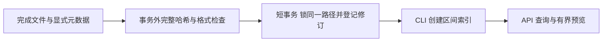

# 阶段二：IQ 接入与区间索引

## 当前范围

本文保留阶段二交付记录。当前阶段三已完成，扫描/分段 CLI 已改为异步提交；
运行当前源码请以 [PHASE_3.md](PHASE_3.md) 和 README 为准。

已实现从受控目录接入完成的 BIN/HDF5、元数据校验、完整哈希、修订追踪、区间读取、
有界分段索引与只读 API。暂无队列、Worker、预测、人工审核、快照和 Web 前端。
扫描/建索引在可信 CLI 中运行，HTTP 不做长时间完整哈希或批量处理；阶段三再接入真实队列。

## 如何理解这一步

可以把原始 IQ 文件理解为一本很厚的书。`raw_files` 登记这本书；`signal_segments` 只记录
“从第几个采样开始、连续读多少个采样”，不会给每个片段再复制一本小书。
`processing_configs` 记录切分规则，规范化参数的 SHA-256 是稳定身份。
扫描日志 `file_observations` 保存登记、验证、变更、失效及重新激活的事实。



## 接入协议

只配置一个逻辑根目录，默认 `RF_DATA_ROOT=./data`、`RF_DATA_ROOT_KEY=default`。
根目录别名是资产身份的一部分。不要在保持同一别名时擅自换成无关的存储内容。
`scripts/dev.py` 会把本机相对数据根目录解析为仓库根下的绝对路径，再切换到 backend 运行。
容器将同一 `./data` 只读挂载到 `/data`，因此本机与容器共享相同 root_key / 相对路径。

采集侧按顺序执行：写 `tone.bin.part` → 关闭 → 原子重命名 `tone.bin` →
写好 `tone.bin.iq.json` → 创建 `tone.bin.done`。完成后不能继续写原文件。
下次修改必须撤销完成标记，待新文件和元数据完成后重新发布标记并扫描。
HDF5 同样先关闭文件，再发布 marker。

BIN sidecar 例：

```json
{
  "format": "BIN",
  "sample_rate_hz": 1000000.0,
  "center_frequency_hz": 100000000.0,
  "dtype": "float32",
  "byte_order": "little",
  "interleaving": "IQ"
}
```

BIN 支持 int16/float32、little/big、I/Q 交织。不自动归一化 ADC 幅度，读取结果为 complex64。
文件长度必须是完整复数采样大小的正整数倍。正有限采样率、非负有限中心频率必填，未知字段拒绝。

HDF5 sidecar 例：

```json
{
  "format": "HDF5",
  "sample_rate_hz": 1000000.0,
  "center_frequency_hz": 100000000.0,
  "dataset_path": "/iq"
}
```

HDF5 支持 `[N] complex64` 或 `[N,2]` 数值型；后者读取后转换 complex64，可能损失高精度数值。
只允许 dataset 路径沿内部 hard link 查找。拒绝软链接、外部链接、虚拟 dataset、外部存储、
空/不支持的布局和超过 16 MiB 的单个 Chunk。区间切片采用 h5py hyperslab；压缩 Chunk
仍可能需要整块解压，所以不能只以返回数组大小估算 I/O 成本。

## 身份、状态和事务

资产唯一身份：`root_key + relative_path + sha256 + metadata_hash`。
内容相同但采样率等解释参数不同，会生成新修订。同内容不同路径暂不自动合并。

每次扫描均对所有完成候选流式计算 SHA-256（8 MiB 块），不以大小/mtime 跳过校验。
扫描和哈希在事务外执行，读取前后核对 stat，并再次验证文件路径、sidecar 和 marker。
同一路径登记使用 PostgreSQL `pg_advisory_xact_lock(hashtextextended(key,0))`，持锁期间只做
短元数据复核和 SQL，不计算完整哈希；`INSERT ... ON CONFLICT DO UPDATE` 保证重复登记幂等。
旧 ACTIVE 修订先变 STALE，再激活新修订；数据库部分唯一索引保证每个路径最多一个 ACTIVE。

- ACTIVE：本次扫描确认有效；预览仍需即时检查。
- STALE：同一路径已发现另一内容或解释修订；历史身份保留。
- INVALID：源缺失、完成标记撤销或扫描失败；修复后重扫可重新激活，日志追加 REACTIVATED。

每个文件独立事务；坏文件不回滚其他已成功文件。返回 errors 时 CLI 退出 2，不假称整个扫描成功。
扫描目录完整枚举后才处理已登记但当前缺失的文件；扫描范围过大或目录无法完整遍历则中止，
避免把未遍历路径误判为丢失。单次最多 1,000 个候选，可配置到 10,000；建议按采集批次扫描。
错误路径失效是保守处理，文件被修好后需重扫确认；它不是采集存储的跨资源事务。

## 分段

```powershell
.\.venv\Scripts\python.exe scripts/dev.py segment --file-id <UUID> --window 256 --stride 128
# 或： --window 256 --overlap 0.5
# 较长文件用 --start 0 --end 65536 限定这次索引区间。
```

窗口和步长单位为复数采样点。默认不重叠；步长不能超过窗口；overlap 必须产生整数步长。
尾部不足完整窗口直接丢弃。规范配置固定 reader_version、pipeline_version 和 tail_policy。
索引前再次完整校验内容/元数据；短事务中锁路径、锁源行、复核当前观察、写配置和全部区间。
每次最多 1,000 个窗口，每窗最多 1,000,000 点，超限在写入前拒绝。
唯一约束 `(raw_file_id,config_id,start_sample,sample_count)` 让重复调用只返回已有区间。
配置写入后遇到故障，整个事务回滚，不留下孤立配置和部分片段；测试有实际故障注入。

## API 与预览

已实现 GET：

- `/api/v1/files`：分页，status/format 过滤，返回各修订与片段数量。
- `/api/v1/files/{id}`：单个文件的元数据、SHA-256、状态、片段数量。
- `/api/v1/files/{id}/observations`：扫描观察历史。
- `/api/v1/segments`：分页，raw_file_id/config_id 过滤。
- `/api/v1/segments/{id}`：区间和固定处理配置。
- `/api/v1/segments/{id}/preview?max_points=512`：I/Q 波形、频率偏移、相对功率谱、统计。

分页 limit 为 1–100；max_points 为 32–2048。预览先释放 SQL 只读事务，再按区间读取；
只读取当前片段（最多 1,000,000 点），FFT 最多使用前 4,096 点。
返回 mean_power/rms/peak_amplitude/DC 等当前区间统计，未把它们伪装成已持久化质量任务。
波形等间隔抽点用于显示；频谱为未标定的 Hann 窗 periodogram 相对 dB，不是 dBm，
也不是默认对整个原始文件做 FFT。NaN/Inf 拒绝返回，避免无效 JSON。

HTTP 预览只做 size/mtime、sidecar 和 marker 检查，不对大文件重算完整哈希。
Windows 扫描与 Linux bind mount 的 device/inode/ctime 可能不同，因此这些字段不跨运行环境比较；
一次预览内部仍用完整本地 stat 对读取前后及重开路径做复核，检查读取中的替换/变更。
因此快速检查一致不等于严格内容未变：恶意恢复 mtime 的同尺寸改写可能要完整重扫才检出。
严格发布/导出仍必须在后续 Worker 中做完整验证。
这一限制依赖“完成文件不可改写”的采集协议；只读挂载无法阻止宿主机管理员更改。

## 路径安全

只接受规范相对路径，拒绝绝对路径、`..`、反斜杠、盘符/ADS、NUL、符号链接及 Windows reparse point。
Linux 用目录 FD、逐层 O_NOFOLLOW 和常规文件检查打开，减小路径检查与打开之间的竞态。
Windows 用逐层检查和打开前后句柄 stat 复核；不宣称拥有 Linux dir_fd 的同等原子保证。
数据根目录必须由可信采集程序/管理员管理，不能允许不可信本地用户任意替换目录。

## 数据库保护

迁移 `0002_assets` 新增 raw_files、processing_configs、signal_segments、file_observations。
触发器禁止修改或删除源身份/片段身份、禁止更改配置与观察历史。源状态和物理观察可更新。
片段 INSERT 触发器检查源存在、ACTIVE、区间不越界且长度匹配配置窗口；不能靠绕过 API 插入非法区间。
这些是业务完整性保护；数据库管理员禁用触发器不在此保证内。

## 运行和学习入口

README 的“阶段二”给出可直接运行的完整命令。重点按以下顺序读代码：

1. `schemas/iq.py`：输入怎么校验，等效重叠参数怎么规范化。
2. `signal_processing/readers.py`：同一个 read(start,count) 怎样适配两种文件。
3. `services/ingestion.py`：哈希在事务外、路径锁和登记在短事务内。
4. `services/segments.py`：稳定配置、唯一约束与整批事务。
5. `api/assets.py`：分页与有界预览，如何把业务异常转换为 4xx。
6. `tests/test_ingestion.py`：用真实 PostgreSQL 证明去重、修订、约束和回滚。

本阶段实际测试与容器联调记录见 TESTING.md。完成后等待你确认，再实现第三阶段队列与故障恢复。

## 本次验收入口

开发库已接入 `demo-phase2/tone.bin` 和 `demo-phase2/tone.h5`，各有31个片段。
API 保持在本机8000端口运行；可打开 `/docs` 或直接 GET `/api/v1/files`、`/api/v1/segments`。
预览数据来自这些合成 IQ 的实际读取与计算，没有生成模型预测。
复验命令（仓库根目录）：

```powershell
docker compose up -d --wait api
.\.venv\Scripts\python.exe scripts/dev.py scan --directory demo-phase2
$env:RF_TEST_DATABASE_NAME = 'rf_dataops_test'
.\.venv\Scripts\python.exe scripts/dev.py test
docker compose --profile test run --rm tests
```

本机57项通过、2项Windows权限跳过；Linux容器59项全部通过。
当前 HTTP 扫描/后台任务尚未启用；下一阶段把接入/分段操作接入 PostgreSQL 队列，
实现独立 Worker、租约、重试、执行版本校验和故障测试。

## 官方参考

- [h5py 区间切片、Chunk 与外部存储](https://docs.h5py.org/en/stable/high/dataset.html)
- [h5py 链接类型](https://docs.h5py.org/en/stable/high/group.html)
- [Python os.open 与 dir_fd](https://docs.python.org/3.11/library/os.html#os.open)
- [SQLAlchemy PostgreSQL ON CONFLICT](https://docs.sqlalchemy.org/en/20/dialects/postgresql.html#insert-on-conflict-upsert)
