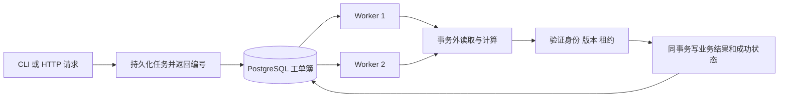
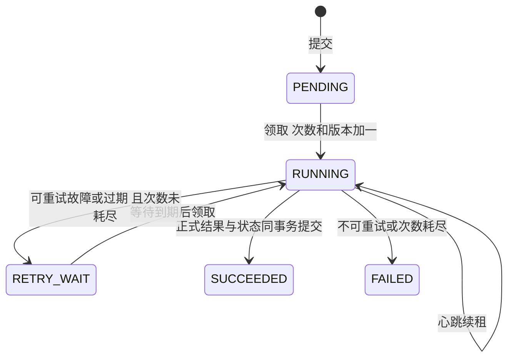

# 阶段三：可靠后台任务

本文保留阶段三交付记录。当前阶段四已加入账号/角色；原 RF_ADMIN_TOKEN 不再用于 HTTP，
读取接口也需登录。当前操作方式以 [PHASE_4.md](PHASE_4.md) 为准。

## 本阶段交付

第二阶段解决“如何安全读取和管理 IQ”；第三阶段解决“耗时处理如何交给后台，并在崩溃后恢复”。
当前 SCAN（扫描接入）、SEGMENT（区间索引）、QUALITY（质量统计）都由真实 Worker 执行。
数据库迁移为 `0003_jobs`；API 和 Worker 是独立进程，Compose 可启动两个 Worker。

可以把任务表理解为共享工单簿。API 写工单并返回编号；Worker 领取工单后做事；
数据库记录谁在做、可做多久、已经尝试几次，以及最后得到什么结果。



## 三个容易混淆的概念

**行锁**解决“两个 Worker 同时抢同一份工单”。`FOR UPDATE SKIP LOCKED` 在短事务中
领取一个任务，更新 RUNNING、attempts、execution_version 和 lease_until 后立即提交。
其他 Worker 跳过已锁工单。计算时不持有该行锁；锁住整个计算过程会阻塞恢复并占用连接。

**租约和心跳**解决“Worker 突然消失”。默认租约 30 秒、每 5 秒续租；独立线程使用自己的
Session。每个 Worker 在领取前及计算期间定期恢复过期任务，最多处理 100 条过期记录一批。
所有 Worker 都退出时，任务仍在数据库中；新 Worker 启动后继续恢复。

**执行版本**解决“旧 Worker 迟到”。每次领取版本加一，令牌包含 job_id、worker_id、
execution_version。完成提交既检查身份和版本，又检查租约；过期 Worker 的结果被拒绝。
同一有效成功令牌及同一结果摘要重放，只返回已有结果。



FAILED 保留原样。重新发起会创建新 generation 和 parent_job_id，便于追溯；不能把历史失败
直接改回待执行。默认总共最多 3 次尝试，含第一次；指数退避默认 2、4…秒，上限 60 秒。
无效参数、源文件变化、NaN/Inf 等不可重试；临时数据库/读取故障可重试。

## 为什么正式结果不会只写一半

`job_work.prepare_work()` 仅在内存形成计划，完整哈希和数值计算在事务外进行。
`JobQueue.complete()` 先锁任务并核对令牌，再调用 `apply_work()` 写业务记录；最后用数据库
当前时钟再次条件更新 SUCCEEDED。若最后租约检查失败，前面已经插入的片段也整体回滚。
成功事件、结果引用、结果摘要和成功状态一次提交。

结果摘要针对规范化的计算计划，排除本机 stat 差异和数据库生成 UUID；不是响应 JSON 字节哈希。
当前不生成磁盘结果文件，因此正式结果全部受同一个 PostgreSQL 事务保护。未来模型文件或导出包
需要单独设计临时路径、不可变输出和垃圾清理，不能直接沿用 SQL 事务宣称磁盘写入原子。

这是至少一次计算加受保护的幂等发布。Worker 可能重复计算，不能称为严格 exactly-once 执行。

## 提交去重如何理解

- HTTP 的 `Idempotency-Key` 是一次请求的编号，8–128 个 ASCII 字符（字母、数字、`_.-`）。
  同编号同规范请求返回原任务；同编号不同请求返回 409。CLI 可显式传 `--request-key`。
- SEGMENT 的逻辑身份含文件修订、区间和规范处理配置；QUALITY 含片段及算法版本。
  不同请求编号也可指向同一逻辑任务。重复提交不会修改原任务的优先级或重试次数。
- SCAN 是一次新的目录观察，因此新请求编号会产生新任务，才能发现新增或变更文件。
  文件本身仍受哈希身份和数据库唯一约束去重。
- `job_requests` 保存请求到任务的映射，`job_events` 保存追加审计；成功和失败任务不允许原地改写。

## 如何运行与查看

在仓库根打开 VS Code，终端执行：

```powershell
docker compose up --build -d --wait --scale worker=2 api worker
docker compose ps -a
.\.venv\Scripts\python.exe scripts/dev.py scan --directory demo-phase3
.\.venv\Scripts\python.exe scripts/dev.py jobs --job-id <上一步返回的任务UUID>
```

`demo-phase3` 是本次已生成的两份小型合成数据。若换新目录，先用
`scripts/generate_demo.py --name 自定义目录名` 生成；已有同名目录会拒绝覆盖。
任务 SUCCEEDED 后，从 `result.files[].id` 取得文件 UUID，再提交：

```powershell
.\.venv\Scripts\python.exe scripts/dev.py segment --file-id <文件UUID> --window 256 --stride 128
# 查询任务；片段也可从 GET /api/v1/segments?raw_file_id=文件UUID 获取
.\.venv\Scripts\python.exe scripts/dev.py quality --segment-id <片段UUID>
.\.venv\Scripts\python.exe scripts/dev.py rerun --job-id <失败任务UUID>
docker compose logs --tail 100 worker
```

CLI 成功退出只证明请求已入队；`worker --once` 也只消费至多一次尝试，退出 0 不证明任务成功。
必须查询数据库任务状态。SCAN 的 SUCCEEDED 表示扫描过程完成；逐文件失败在 `result.errors`，
未完成文件在 skipped 计数，调用者需要检查。整个目录不可读才是任务级失败。

本机调试时可以只启动容器 db，然后在两个 VS Code 终端分别运行 `scripts/dev.py api` 和
`scripts/dev.py worker`，解释器选项目 `.venv`。本机和容器要使用相同根目录别名和实际文件内容。

写 HTTP 接口在 `/docs` 点 Authorize，填写本地 `.env` 的 `RF_ADMIN_TOKEN`；不要分享该值。
没有配置令牌返回 503，缺失或错误令牌返回 401。当前只是本地管理员门禁，完整用户登录和三角色
在阶段四实现；CLI 是持有数据库凭据的可信本机入口。具体请求例子见 [API.md](API.md)。

## 代码阅读顺序与技术取舍

| 文件 | 重点 |
|---|---|
| `app/schemas/jobs.py`、`api/jobs.py` | 强类型参数、202、幂等键、本地管理员令牌 |
| `app/models/jobs.py`、迁移 `0003_jobs` | 任务字段、唯一约束、部分索引、不可变触发器 |
| `app/services/job_queue.py` | claim / heartbeat / recover / fail / complete 的真实条件 SQL |
| `app/services/job_work.py` | 计算计划与正式写入分开；三种任务 |
| `app/workers/runner.py` | 独立心跳、恢复循环、错误分类和安全日志 |
| `tests/test_jobs.py` | 多进程、强杀、重放及回滚的证据 |

文件均位于 `backend/`。SQL 展开、索引及故障矩阵见 [TASK_SCHEDULER.md](TASK_SCHEDULER.md)。
选择 PostgreSQL 队列让任务与业务结果共用事务，也避免引入 Redis/Celery 双写。代价是数据库轮询、
历史增长及公平性限制；SKIP LOCKED 不保证严格 FIFO，也不保证低优先级任务不会饥饿。
生产规模扩大后可评估外部队列与 Outbox，目前先把事务语义做正确。

## 验证结果与当前边界

2026-10-20 实际完整测试：Windows 77 passed、2 skipped；Linux 容器 79 passed、无跳过。
Windows 两项是创建符号链接缺少系统权限，Linux 已真实通过。保留 1 条 Starlette TestClient
弃用警告。迁移升级/降级/升级与 Alembic 无漂移检查通过。

故障测试包含两个真实子进程争抢同任务、运行中强杀 Worker、过期恢复、旧令牌提交被拒绝、
最大次数耗尽、成功重放、不同摘要冲突、插入后异常回滚，以及写入后租约到期的最终检查回滚。
没有以 SQLite 或进程内锁代替 PostgreSQL；故障注入只存在于测试代码。

真实 HTTP + 两个容器 Worker 联调新增 2 源、62 片段引用、4 个 quality-v1 结果，四次预览各 64 点，
RMS 约 0.99999998；两个 Worker 均有成功任务。还验证 401、幂等重放、409 和失败后新代重发。
本地证据为被 Git 忽略的 `artifacts/phase3-http.json`、`artifacts/pytest-phase3-local.xml`。

单次扫描至多 100 个候选路径（与已登记待检查路径并集受限），大目录需手动按子目录提交；
单任务片段数默认至多 1000，超限需手动指定 start/end 拆分；单区间至多 100 万采样。
当前没有自动拆任务、取消/抢占、任务公平性保证或性能容量结论。质量结果是基础数值统计，
没有物理标定、模型识别或人工标签。采集端必须遵守完成后不再改写的协议。

阶段三已交付；经你确认后再开始阶段四的模型适配、用户认证、人工审核及基础审核页面。
