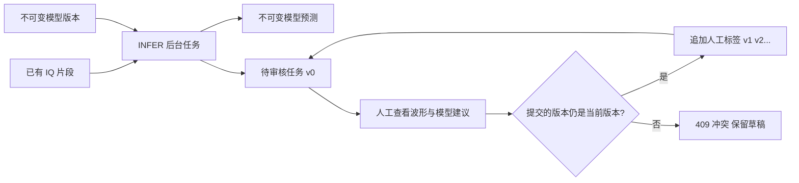

# 阶段四：模型建议与人工审核

本文保留阶段四交付记录。当前阶段五已加入完整资产操作、数据集版本和Manifest，运行入口及
最新范围见 [PHASE_5.md](PHASE_5.md)。

## 已交付的流程

现在可以登录浏览器，选择片段和模型版本，把推理交给独立 Worker；得到明确标记为 Mock 的
模型建议，然后查看 IQ 波形/频谱，确认、修改标签或标记未知。每次人工操作保留人员、时间、
版本及备注。研究人员可读取，审核人员和管理员可改标签，管理员可发起后台处理和登记 Mock 模型。



模型预测与人工标签是两张独立的表。新模型运行不会把人工结论变回待审核，也不会修改旧人工
历史。Mock 的类别和分数由确定性规则产生，仅用于工程联调；它没有识别准确率含义。
即便人工点击“确认模型建议”，也会生成由真实登录用户提交的独立人工记录，保留预测引用。
合成单音数据上的标签只是演示审核操作，不是实测调制类别真值。

## 第一次打开

仓库根目录运行：

```powershell
docker compose up --build -d --wait --scale worker=2 frontend api worker
```

打开 <http://127.0.0.1:18080>。本次已创建三个演示账号，随机密码保存在本地被 Git 忽略的
`artifacts/demo-accounts.json`，请在 VS Code 中打开该文件查看。用户名为 demo_admin、
demo_reviewer、demo_researcher；没有固定默认密码。该文件不要提交或分享。

全新环境先安装 README 中的 Python 依赖，再创建演示账号与模型（重复创建会拒绝，不覆盖密码）：

```powershell
.\.venv\Scripts\python.exe scripts/dev.py admin demo-accounts --output ../artifacts/demo-accounts.json
.\.venv\Scripts\python.exe scripts/dev.py admin mock-model
```

`scripts/dev.py` 内部切换到 backend，因此上面的输出路径使用 `../artifacts`。
也可交互创建个人账号，密码通过隐藏输入读取：

```powershell
.\.venv\Scripts\python.exe scripts/dev.py admin create-user --username your_admin --role ADMIN
```

账号密码长度 12–128 字符；用户名是 3–64 位小写字母、数字、`_.-`。
管理员令牌 RF_ADMIN_TOKEN 已退出 HTTP 认证；第三阶段旧脚本需改为登录后使用会话令牌。
CLI 仍是持有数据库凭据的可信本机管理入口，不提供公开注册、任意角色自选或重置他人密码 API。

## 浏览器操作

1. 用管理员登录“片段与预测”，选中一行片段，选择 mock-modulation / mock-v1，提交预标注。
2. 等待后台完成，再到“人工审核”。点击左侧样本，查看波形、相对功率谱、模型版本和各类别分数。
3. 选择自己的类别并保存，或确认当前模型建议，或标记未知；备注可记录判断依据。
4. 查看下方历史。更改只增加版本，不删除之前的记录。
5. 用研究人员账号登录，能够查看但不能修改标签；用审核人员账号可以提交人工结论。

队列按可用预测中的最低分数排序，可筛选审核状态和分数不超过 60% 的样本。分数只用于排序，
尤其 Mock 分数不能当成准确概率。没有符合条件的任务会显示真实空状态。
左侧队列每页20条；预测最多显示100个模型版本，历史显示最近100条并提示总数，API支持分页读取其余记录。

## 两人同时修改时发生什么

假设 A、B 都打开人工版本 v0。A 提交后，服务器将版本更新为 v1，并在同一事务写入历史。
B 提交仍携带 expected_version=0，SQL 条件更新影响零行，返回 REVIEW_VERSION_CONFLICT 409。
页面保留 B 的标签/备注草稿，禁止继续提交，只有明确点击“重新加载并放弃当前草稿”后才刷新版本。
服务器不会自动把 B 的旧提交改成 v1 再覆盖 A。

```sql
UPDATE review_tasks
SET label_version = label_version + 1,
    current_annotation_id = :new_annotation_id,
    status = :new_status, updated_at = clock_timestamp()
WHERE id = :review_id AND label_version = :expected_version
RETURNING label_version;
-- 同一事务 INSERT annotations；失败则版本和当前指针一起回滚。
```

current_annotation_id 使用延迟外键，允许先 CAS 再插入历史；提交时约束触发器验证指针、最新版本、
所属审核任务和 UNKNOWN 状态一致。历史不可 UPDATE/DELETE，不能通过直接 SQL 绕过正常版本递增
追加下一条标签。reviewer_id 来自认证上下文，客户端传入该字段会被拒绝。

## 登录方案及边界

密码使用 Python 标准库 PBKDF2-HMAC-SHA256、每用户随机盐、600000 次迭代。
取舍是无需额外密码库，适合本地演示；参考 [OWASP 密码存储建议](https://cheatsheetseries.owasp.org/cheatsheets/Password_Storage_Cheat_Sheet.html)。
更大规模部署可考虑 Argon2id 并设计旧哈希升级。

登录签发高熵随机不透明会话令牌，数据库只存 SHA-256 摘要；默认30分钟过期，支持退出删除会话。
每个认证请求检查用户是否仍启用、当前角色和数据库时间。浏览器只在内存保留令牌，不存 localStorage；
刷新需重新登录。过期和禁用均立即拒绝后续请求。健康接口与 OpenAPI 仍公开，业务读取要求登录。
请求校验响应移除 input，避免非法密码被 FastAPI 默认错误结构回显。

每个规范用户名60秒最多5次登录尝试（成功尝试也计入），计数由 PostgreSQL 锁保护，可跨 API 进程生效。
当前是账号级限制，尚无 IP 全局限制、MFA、密码找回、会话管理页或互联网抗滥用体系。
仍只绑定本机端口；外网部署需要 TLS、独立最小权限数据库角色、备份及监控。

## 真实 PyTorch 模型接入合同

`ModelAdapter` 输入一个有限、非空的一维复数 IQ 数组；输出类别、完整分数字典、最大分数、耗时和
is_mock。模型版本固定适配器、类别顺序和预处理版本。预测唯一身份为 segment_id + model_version_id。

保留的 TorchScript CPU 适配器约定：

- 输入 float32 `[1,2,N]`，I/Q 两通道；预处理 `iq-rms-v1` 将复数 RMS 归一化，零信号保持零。
- 输出 logits `[1,C]`，服务端 softmax；类别顺序必须与注册参数完全一致。
- 仅加载运维人员信任并登记的本地 TorchScript；完整 SHA-256 校验和加载使用同一个已打开文件。
- 权重位于 RF_MODEL_ROOT（本机 `models/`，容器 `/models` 只读挂载），不接受 HTTP 上传或任意服务器路径。

例：准备可信 `models/modulation.pt`，然后在安装了兼容 PyTorch CPU 包的运行环境执行：

```powershell
.\.venv\Scripts\python.exe scripts/dev.py admin torch-model --name modulation --version v1 --artifact modulation.pt --samples 256 --labels BPSK,QPSK,8PSK,16QAM,64QAM
.\.venv\Scripts\python.exe scripts/dev.py infer --segment-id <片段UUID> --model-id <模型UUID>
```

普通 state_dict / `.pth` 并不自动满足合同，需要原网络构造与正确转换；预处理不同也需新适配器。
**本次没有真实权重，未安装 PyTorch、未运行真实模型推理，也没有训练模型。**
已验证的是 Mock 流程以及不匹配输入/缺少运行时的拒绝路径；真实模型加载、精度、性能仍待接入后验证。

## 事务、代码与测试

INFER 沿用阶段三租约队列：事务外完整校验源并推理，完成事务核对令牌后写预测、创建审核任务、
标记成功。旧执行不能发布；预测插入后失败会全量回滚。预测语义摘要排除浮动耗时，使同结果重放幂等。

| 文件 | 可学习的内容 |
|---|---|
| `backend/app/services/authentication.py`、`api/auth.py` | 密码哈希、会话、登录限流、角色校验 |
| `backend/app/signal_processing/models.py` | Mock 与可替换的真实适配器合同 |
| `backend/app/services/job_work.py` | INFER 计划、租约保护与结果发布 |
| `backend/app/services/labeling.py`、`api/labeling.py` | 模型登记、审核查询与乐观锁事务 |
| `backend/alembic/versions/0004_labeling_*.py` | 外键、历史保护、提交时一致性检查 |
| `frontend/src/App.vue` | Vue 页面状态、API请求、409草稿保护及 ECharts |
| `backend/tests/test_labeling.py` | 登录、权限、并发冲突、不覆盖人工与故障回滚 |

本阶段新增11项测试，完整结果 Windows **88 passed / 2 skipped**，Linux **90 passed**。
Windows 两项仅为符号链接权限不足，Linux 已通过；保留1条 Starlette httpx TestClient 弃用警告。
迁移新库全量升级、降级到 base、重新升级和 Alembic 无漂移均通过。
若已有 INFER 历史，降级至阶段三会明确拒绝，避免静默删除任务历史；生产降级需另行归档规划。
浏览器及真实 HTTP 联调记录见 TESTING.md。
实际界面截图位于本地 `artifacts/phase4-review.png`。浏览器测试会为每次运行新建小型合成输入，
经过HTTP队列接入/分段，避免依赖上次演示样本仍未审核；测试源码为frontend/tests/review.spec.js。

## VS Code 开发与下一阶段

```powershell
# 后端依赖仍使用现有 .venv；数据库与 Worker 可继续由容器提供。
# 修改后端需重建容器，或停掉容器 API，在独立终端运行 scripts/dev.py api。
cd frontend
npm ci
npm run dev
```

本机 Vite 地址 <http://127.0.0.1:5173>，通过同源代理请求8000端口 API，无需放开跨域。
Compose 则由非 root Nginx 提供18080页面及同源代理。前端采用 Vue 3 + Vite + Element Plus + ECharts + Axios，
版本由 package-lock.json 固定，`npm run build` 可独立检查。不会把账户密码或数据库凭据打包到网页中。

阶段四完成后等待你审查。阶段五再做不可变数据集版本、Manifest，以及完整资产/数据集管理页面。
