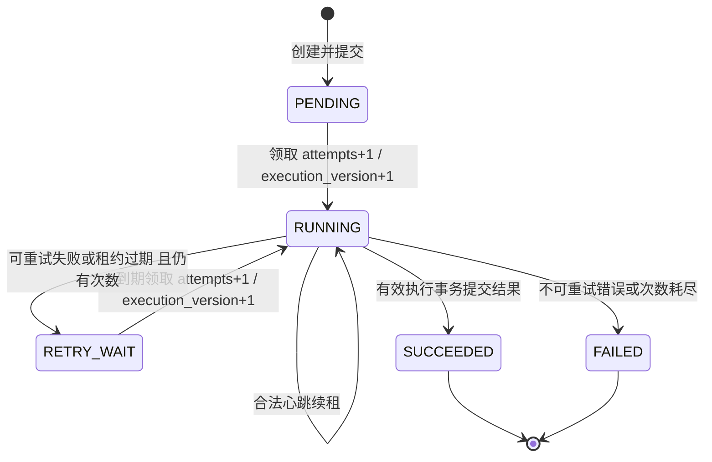

# 多 Worker 状态机与事务实现（阶段三）

本文对应 `app/services/job_queue.py`、`job_work.py`、`app/workers/runner.py` 和迁移 `0003_jobs`。
`tests/test_jobs.py` 已在真实 PostgreSQL、Windows 和 Linux 执行，记录见 TESTING.md。
阶段四新增INFER与模型外键，沿用相同领取/租约/发布事务；HTTP改为账号会话及ADMIN权限。
预测语义摘要排除耗时，预测及审核任务与SUCCEEDED同事务提交，新预测不覆盖已有人工状态。

## 状态机



FAILED 不原地无限重置。管理员“重新发起”创建带 parent_job_id 的新 generation，
新任务 attempts=0，并审计原因。原 FAILED 保留。PENDING/RETRY_WAIT 初始就有 next_run_at。

## 领取：短事务，锁不跨越计算

实现的等价 SQL（SQLAlchemy 构造，绑定变量，数据库时钟）：

```sql
BEGIN;
WITH candidate AS (
    SELECT id
    FROM processing_jobs
    WHERE root_key = :root_key AND status IN ('PENDING', 'RETRY_WAIT')
      AND next_run_at <= clock_timestamp()
      AND attempts < max_attempts
    ORDER BY priority DESC, next_run_at, created_at, id
    FOR UPDATE SKIP LOCKED
    LIMIT 1
)
UPDATE processing_jobs AS j
SET status = 'RUNNING', worker_id = :worker_id,
    attempts = j.attempts + 1, execution_version = j.execution_version + 1,
    lease_until = clock_timestamp() + make_interval(secs => :lease_seconds),
    updated_at = clock_timestamp()
FROM candidate WHERE j.id = candidate.id
RETURNING j.*;
-- 同事务追加 CLAIMED 事件
COMMIT;
-- 现在才做 IQ 读取/处理；未领取到任务则有上限地退避轮询。
```

行锁使同一行同时只能由一个领取事务修改；SKIP LOCKED 允许其他 Worker 跳过已锁行，
而不排队阻塞。它不是一般查询的一致视图，也不保证严格 FIFO 或低优先级不饿死。
仅用 SELECT 再 UPDATE 会重复领取；只用进程内锁在多进程部署中无效。

实际部分索引：

```sql
CREATE INDEX ix_jobs_claim
ON processing_jobs (root_key, priority DESC, next_run_at, created_at, id)
WHERE status IN ('PENDING', 'RETRY_WAIT');
CREATE INDEX ix_jobs_expired ON processing_jobs (root_key, lease_until, id)
WHERE status = 'RUNNING';
```

## 心跳与恢复

初值租约 30 秒，心跳 5 秒，恢复扫描每 5 秒、小批次 100 条；数值可配置。
每次领取的令牌为 `(job_id, worker_id, execution_version)`，worker_id 用进程启动 UUID。

```sql
UPDATE processing_jobs
SET lease_until = clock_timestamp() + make_interval(secs => :lease_seconds),
    updated_at = clock_timestamp()
WHERE id = :id AND root_key = :root_key AND status = 'RUNNING'
  AND worker_id = :worker_id AND execution_version = :execution_version
  AND lease_until > clock_timestamp();
```

更新零行表示失去所有权，停止续租与发布。过期执行不能通过心跳复活，即使恢复器尚未扫描。
独立心跳 Session 保证计算期间不长持 SQL 锁；心跳线程同样不得和计算共享 Session。

每个 Worker 周期运行恢复批次，SELECT FOR UPDATE SKIP LOCKED 锁住过期 RUNNING 行，
在锁内再次确认租约。`attempts >= max_attempts` 转 FAILED，否则 RETRY_WAIT，并清空 lease/worker。
多恢复器可并存；恢复与心跳争同一行锁，条件判断以数据库当前值为准。只在领取时增加 attempts
与 execution_version；恢复到非 RUNNING 已足以使旧执行失效。
若全部 Worker 退出，任务持久保留，新的 Worker 启动即运行恢复；MVP 不增加独立调度服务。

退避 `min(2 ** (attempts - 1) * RF_RETRY_BASE_SECONDS, 60)` 秒，默认基数 2；当前无随机抖动。
max_attempts 默认 3，包含第一次执行。无效元数据、越界、源文件变化、配置不兼容是不可重试错误；
瞬时数据库/存储中断可重试。失败持久化本身失败时不假称已处理，由租约恢复最终接管。

## 结果提交与幂等

每次任务结果数量受限。计算只在内存中形成有界结果；MVP 不写大型磁盘中间结果。
超过单任务片段上限的请求会拒绝，调用者需手动用 start/end 按稳定区间拆任务；尚无自动拆分器。

完成流程必须是一个事务：

1. 锁任务行。若 SUCCEEDED 且同一执行令牌和结果 digest 重放，返回已发布结果，禁止再写。
   同令牌不同 digest 是冲突；旧令牌不得读取成“自己提交成功”。
2. 检查 RUNNING、worker_id、execution_version、lease_until 有效；不满足则回滚并抛出 StaleExecution。
3. 登记扫描资产、插入/核对区间或质量身份；质量唯一冲突时比较指标 digest，不覆盖不同结果。
4. 用相同条件再次 UPDATE 任务为 SUCCEEDED，写 digest 和事件；影响零行则整体回滚，包括第 3 步。
5. COMMIT。所有正式结果与成功状态同时可见，计算期间没有数据库事务。

最后条件 UPDATE 是完成提交的线性化点，数据库时钟在此点检查租约；行锁持有到提交，恢复器
不能在二者之间回收。不是以客户端时钟判断，也不要求网络响应到达客户端时租约仍有效。
连接提交后响应丢失时，原令牌可幂等重放。新执行版本不能覆盖旧成功结果，旧 Worker 更不能
用不带 fencing 条件的业务 INSERT 绕过所有权检查。

任务去重 key 为 root_key + 类型 + 规范 payload 的哈希。SEGMENT 含源修订、区间、处理配置，
QUALITY 含片段与质量算法版本；SCAN 还含请求编号，因此新编号会执行新的目录观察。
generation 区分管理员重发；`job_requests` 保存独立唯一请求编号及请求体摘要，多请求可指向同任务。
片段和质量各自有业务唯一约束。阶段四已加入INFER：片段与不可变model_version_id共同构成身份，
当前白名单不包含任意函数/命令执行入口。
result_digest 是规范计算计划的语义摘要，排除环境 stat、数据库生成 UUID 和登记计数；
成功重放返回首次存储的 result，不重复登记或写事件。它不是 HTTP 响应字节的校验哈希。

若未来需写磁盘输出：仅写 `tmp/job_id/execution_version/随机UUID`，绝不直接覆盖正式名称；
先完成文件、fsync 和原子重命名到唯一不可变结果路径，再在 fenced 事务中登记引用。
过期输出只能成为无引用孤儿，由 GC 清理；不能凭“临时文件改名成功”就发布业务结果。

## 故障验证矩阵（已运行于真实 PostgreSQL）

| 场景 | 测试方法 | 断言 |
|---|---|---|
| 两 Worker 竞争 | 两个独立进程，barrier 同步领取一个任务 | 恰一令牌成功，attempts=1 |
| 强杀 Worker | 子进程领取后通知父进程，父进程 terminate/kill | 行为 RUNNING，锁已释放，租约最终可恢复 |
| 超时再领取 | 用测试 SQL 将该任务 lease_until 调到过去，运行恢复器 | 新版本递增、次数递增、身份改变 |
| 旧 Worker 迟到 | 保留旧令牌，恢复后尝试 heartbeat/complete | 零行更新，无旧业务记录，无状态污染 |
| 次数耗尽 | 可重试失败及崩溃两条路径，重复到上限 | FAILED，不可再次领取 |
| 提交响应丢失 | 同令牌/digest 连续 complete 两次 | 只一组结果，第二次返回已存在 |
| 错误重放 | 同令牌不同 digest，或过期不同令牌 | 明确冲突，不覆盖结果 |
| 提交中断 | 插入部分结果后抛错或断连 | 所有业务插入回滚，任务不能假成功 |
| 提交途中租约到期 | 写入后 pg_sleep，再执行最后条件 UPDATE | 整批业务写入回滚，无成功状态 |

提交中断当前测试采用业务写入后抛异常；不声称覆盖所有网络断连时序。
核心测试对应 `test_two_processes_claim_only_one_job`、
`test_killed_worker_recovers_and_old_execution_cannot_publish`、
`test_result_transaction_rolls_back_all_business_rows` 和
`test_final_lease_fence_rolls_back_already_inserted_rows` 等，未用 SQLite 或内存锁替代。
当前单次 SCAN 最大 100 路径、默认最多 1000 片段/任务；无取消、抢占、自动拆任务及公平性承诺。

## 阶段五：PUBLISH结果发布

新增dataset_id外键，仅PUBLISH非空；输入固定dataset、筛选、版本、发布者和预览摘要。
准备阶段完整校验最多100个源，不写正式版本。完成阶段用REPEATABLE READ，第一条SQL前设置隔离级别，
在同一一致视图中重新筛选并核对摘要，封存版本/成员/Manifest，再执行原来的最终租约fence。
RR序列化失败按OperationalError有限重试；逻辑选择变化为SELECTION_CHANGED，要求重新预览新请求。
同令牌/同计划摘要重放复用第一次结果；失败/过期提交不留下封存版本。
完整磁盘输出未引入，Manifest文本在PostgreSQL同事务持久化，详情见PHASE_5.md。
