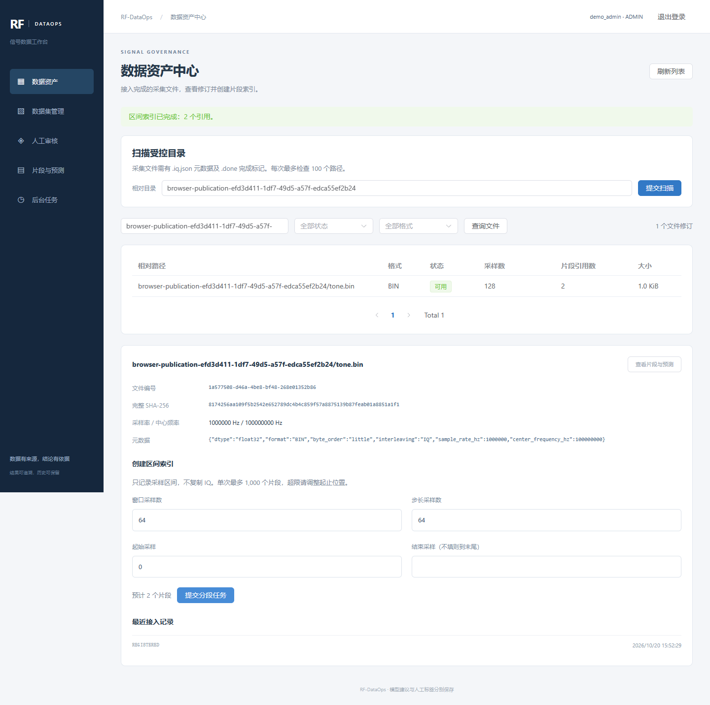
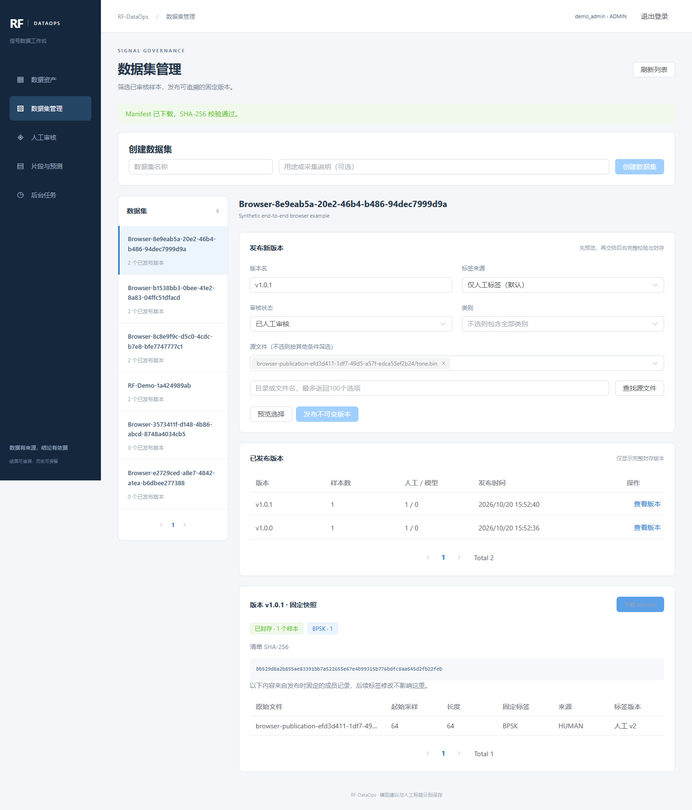

# RF-DataOps 使用手册

适用版本：五阶段核心 MVP，数据库迁移 `0005_datasets`。整理日期：2026-10-21。

本文面向第一次使用本项目的人。**先读第 1 节了解平台用途，再按第 4.1 节逐项点击，完成第一次练习。** 第 5–10 节用于查询详细规则和排查问题，暂时不需要理解代码或数据库。

## 阅读导航

| 你现在想做什么 | 看哪里 |
|---|---|
| 不知道平台有什么用 | 第 1 节：用途、页面说明和常用词 |
| 不知道项目在哪、怎么打开 | 第 2–3 节：VS Code、启动和登录 |
| 想照着按钮操作一次 | [第 4.1 节：第一次完整操作](#first-operation) |
| 想让脚本替你跑完演示 | 第 4.2 节：自动演示 |
| 不知道“测试数据”为什么导不进来 | [第 8.1 节：你的 HetRF-Mix 数据说明](#hetrf-mix) |
| 想手动导入已经整理好的 HetRF-Mix 演示子集 | [第 8.2 节：20 个可直接扫描的文件](#hetrf-ready) |
| 想备份或排查错误 | 第 9–10 节 |

## 1. 这个项目能做什么

RF-DataOps 是一个电磁信号数据治理与标注管理平台。你把采集完成的 IQ 文件放进指定目录，系统登记文件、创建信号片段、执行检查和模型预标注，再由人工审核，最后发布固定的数据集版本。

用日常语言说：**这是一个帮助你整理信号文件、查看信号、记录分类结论，并保存每一版实验数据依据的工作台。**

例如，你收到一批信号文件，想知道“有哪些文件、每段信号是什么类别、谁审核过、某次实验究竟用的哪一批标签”。这个平台把这些信息关联起来，便于查询和追溯。

第一次练习可以这样理解结果：导入一个小文件 → 取出 3 段信号 → 选择其中 1 段生成模拟预测 → 人工确认 → 把这 1 个已审核样本发布为 `v1.0.0`。最后你能下载一份写明来源、位置和标签的清单。


| 功能 | 目前可以完成的操作 |
|---|---|
| 登录与权限 | 管理员、审核人员、研究人员三种角色；登录、退出和会话过期 |
| 数据资产 | 接入 BIN/HDF5；按路径、状态、格式查询；查看元数据、完整 SHA-256 和接入历史 |
| 文件修订 | 发现同一路径的内容或元数据变化，保留旧身份和历史 |
| 信号分段 | 按窗口、步长、起止采样创建区间索引；不复制每个片段的原始数据 |
| 预览与检查 | 查看 I/Q 波形、相对功率谱和统计；通过后台任务保存质量结果 |
| 模型预标注 | 选择模型版本，为片段提交推理任务；保存模型建议和分数 |
| 人工审核 | 确认模型建议、修改类别、标记未知；保存人员、时间、备注和版本历史 |
| 多人协作 | 检出同时修改的冲突，保留未提交草稿，避免静默覆盖 |
| 数据集发布 | 筛选样本、预览数量和类别分布、发布不可变版本、下载清单并校验哈希 |
| 后台任务 | 查询扫描、分段、质量、推理、发布任务；查看错误、事件和重试记录 |
| 本地维护 | 一键启动与合成演示、数据库备份、隔离恢复验证、自动化测试 |

**目前模型演示使用 Mock。** 它生成模拟类别和分数，用来验证软件流程，不代表识别准确率。真实模型适配接口已经预留，但真实权重、精度、性能及生产部署仍需后续验证。

### 1.1 左边五个菜单分别做什么

| 左侧菜单原文 | 什么时候进入 | 在这里做什么 |
|---|---|---|
| 数据资产 | 刚准备好源文件时 | 提交扫描，让系统认识文件；选中文件并创建片段 |
| 片段与预测 | 已经创建片段后 | 选择一个片段，执行质量检查、提交模型预标注 |
| 人工审核 | 模型预标注成功后 | 看波形和建议，保存自己的判断，查看修改历史 |
| 数据集管理 | 有了已审核样本后 | 选择样本，发布固定版本，下载 Manifest 清单 |
| 后台任务 | 想确认处理进度或原因时 | 看排队、处理中、成功或失败，以及具体错误 |

登录后可能先看到“人工审核”页。空列表表示当前筛选下没有样本；第一次操作请主动点击左侧“数据资产”。菜单的视觉排列顺序不代表使用顺序。

### 1.2 不熟悉的词，看这张表

| 页面或手册里的词 | 可以怎样理解 |
|---|---|
| IQ 文件 | 保存信号采样的原始文件；每个点由 I、Q 两个分量组成 |
| 元数据 `.iq.json` | 文件的说明书，告诉系统采样率、格式和数据位置 |
| 完成标记 `.done` | 表示文件已写完，可以开始读取；扫描不会替你创建它 |
| 扫描 / 接入 | 检查指定目录，把符合要求的文件登记到平台 |
| 分段 / 窗口 / 步长 | 记录每次看多长的一段信号，以及下一段向后移动多少点 |
| 质量检查 | 计算信号的功率、幅度等统计，保存检查结果 |
| 预标注 / 预测 | 模型先给一个建议，等待人工判断 |
| Mock | 模拟模型，用于练习软件流程 |
| 后台任务 / Worker | 网页提交工作，由独立处理程序在后台执行；需要等待结果 |
| SHA-256 | 文件内容的校验指纹，用于识别或核对文件 |
| 数据集 | 为某个用途组织的一组样本，例如“第一次练习” |
| 固定版本 / 快照 | 保存发布时选中的成员和标签，后续改标签不会改掉旧版本 |
| Manifest | 描述这版用了什么数据的 JSON 清单，文件里保存的是引用和说明 |

### 1.3 哪些事情目前还不会自动发生

| 你的操作或期待 | 当前实际行为 |
|---|---|
| 把文件复制进 `data/` | 仅完成存放；还需要手动提交扫描，没有目录自动监控 |
| 点击“刷新列表”或“查询文件” | 读取已经登记的信息，不会扫描磁盘发现新文件 |
| 扫描成功 | 登记了符合要求的源文件；还需要分别分段、预标注和人工审核 |
| 添加任何 `.h5` 文件 | 还需要配套说明和完成标记，且内部数组必须符合支持的布局 |
| 想让平台训练新模型 | 当前没有训练功能；已实现预标注任务和模型接入接口 |
| 下载数据集 | 当前下载 Manifest，不会把原始 IQ 和模型打成压缩包 |
| 希望导入现成标签 | 当前没有批量导入外部标签的操作入口，也没有 26 类多标签审核流程 |

## 2. 项目在哪，哪些文件需要保留

当前电脑的项目目录：

```text
C:\Users\39675\.codex\.chatgpt-projects\g-p-6ab891bbc5488191b50279f531d676f2\rf-dataops
```

在 VS Code 中选择“文件 → 打开文件夹”，打开上面的 `rf-dataops`，然后选择“终端 → 新建终端”。下文命令都在这个项目目录执行，除非特别说明。

| 路径 | 用途 |
|---|---|
| `backend/` | Python 后端、数据库迁移和测试 |
| `frontend/` | Vue 页面和浏览器测试 |
| `scripts/` | 启动、生成演示数据、管理账号和备份脚本 |
| `docs/` | 本手册、架构、接口和分阶段记录 |
| `data/` | 默认原始 IQ 存储目录；容器只读访问这里 |
| `models/` | 可信模型文件目录；当前 Mock 无需真实权重 |
| `artifacts/` | 私有账号文件、运行报告、下载示例和数据库备份 |
| `.env` | 本地私有配置，包含数据库凭据 |
| `.venv/` | 本机 Python 虚拟环境 |

`data/`、`models/`、`.env`、账号和备份等私有内容不随 Git 同步。搬到新电脑时，需要另外准备数据和配置。外层 `sources/` 是只读参考资料，不是开发目录。

## 3. 首次启动与登录

### 3.1 环境要求

- Python 3.11 或更高版本。
- Docker Desktop 已启动，并使用 Linux 容器引擎。
- 首次安装依赖和构建镜像时需要网络。
- 如果只使用容器版工作台，不需要在本机安装 Node.js；修改前端并进行本机热更新时才需要。

在 VS Code 的 PowerShell 终端中执行：

```powershell
python --version
docker info --format '{{.OSType}}'
python scripts/quickstart.py
```

第二条命令应显示 `linux`。一键脚本会准备虚拟环境和依赖，初始化缺失的私有配置，执行迁移，启动数据库、API、两个 Worker 和前端，并准备演示账号与 Mock 模型。

脚本复用已有配置和账号，不清空数据库。若账号文件与当前数据库不匹配，它也不会自动重置密码。

### 3.2 打开系统

| 入口 | 默认地址或位置 |
|---|---|
| 网页工作台 | [http://127.0.0.1:18080](http://127.0.0.1:18080) |
| API 文档，供开发调试 | [http://127.0.0.1:8000/docs](http://127.0.0.1:8000/docs) |
| 就绪检查 | [http://127.0.0.1:8000/health/ready](http://127.0.0.1:8000/health/ready) |
| 本地账号与随机密码 | `artifacts/demo-accounts.json` |

若 `.env` 调整过端口，以配置为准。请在本地 VS Code 中查看账号文件；不要把密码复制到公开文档或提交 Git。

第一次体验建议使用 `demo_admin`，可以完成整个流程。网页刷新后需要重新登录；默认会话有效期为 30 分钟。连续登录过于频繁会触发限制：每个用户名 60 秒内最多 5 次尝试，成功登录也计入。

### 3.3 三种账号有什么区别

| 操作 | 管理员 ADMIN | 审核人员 REVIEWER | 研究人员 RESEARCHER |
|---|---|---|---|
| 查看资产、片段、预测、审核、任务及已发布数据集 | 可以 | 可以 | 可以 |
| 提交扫描、分段、质量、推理任务 | 可以 | 不可以 | 不可以 |
| 提交人工结论 | 可以 | 可以 | 不可以 |
| 创建数据集、预览选择、发布版本 | 可以 | 不可以 | 可以 |
| 重新发起失败任务 | 各类任务 | 不可以 | 仅 PUBLISH 发布任务 |

模型登记和账号创建由可信本机管理命令完成，当前没有网页注册、密码找回或账号管理页面。

## 4. 第一次使用：照着完成一次练习

<a id="first-operation"></a>

### 4.1 手把手操作：每一步点哪里

**练习目标：** 在网页发布一个包含 1 个已审核样本的版本。全程使用 `demo_admin`，不需要在三种账号之间来回切换，也不需要真实模型。生成数据的命令只需执行一次，后面的工作在网页完成。

**步骤一：打开项目并启动。** 打开 Docker Desktop；在 VS Code 中打开第 2 节的项目文件夹，选择“终端 → 新建终端”。如果不知道终端是否在正确目录，可以先完整执行下面两行：

```powershell
Set-Location -LiteralPath 'C:\Users\39675\.codex\.chatgpt-projects\g-p-6ab891bbc5488191b50279f531d676f2\rf-dataops'
python scripts/quickstart.py
```

等待命令成功结束，浏览器打开 [http://127.0.0.1:18080](http://127.0.0.1:18080)。如果失败，先查看第 10 节；不要在服务未启动时继续下面的页面操作。

**步骤二：登录。** 在 VS Code 左侧文件列表展开 `artifacts`，打开 `demo-accounts.json`。找到用户名为 `demo_admin` 的记录，将该记录里的用户名和密码填进网页，点击“登录”。密码不是固定的 `admin` 或 `123456`，也不用填写 JSON 中的字段名和引号。

**步骤三：生成可以直接导入的练习文件。** 回到项目终端执行：

```powershell
.\.venv\Scripts\python.exe scripts/generate_demo.py --name tutorial-first
```

成功后，VS Code 的 `data/tutorial-first/` 中会出现 `tone.bin`、`tone.h5` 及各自配套的 `.iq.json`、`.done`。如果提示目录已经存在且文件完整，直接使用这批文件；需要全新练习时换一个名字，并把后面所有 `tutorial-first` 同步换成新名字。不要覆盖自己的真实数据。

**步骤四：在网页依次操作下面的表格。每一行完成并看到右侧结果后，再进行下一行。**

| 顺序 | 在哪个页面 | 填什么、点什么 | 预期看到什么 |
|---|---|---|---|
| 1 | 数据资产 | 在顶部“相对目录”填 `tutorial-first`，点“提交扫描” | 等待扫描结束；首次接入 2 个文件，已存在时显示已有；错误应为 0 |
| 2 | 数据资产 | 在列表上方的路径搜索框填 `tutorial-first/tone.bin`；状态、格式保留全部，点“查询文件” | 列表出现练习的 BIN 文件；点击那一行后，下方出现文件详情 |
| 3 | 数据资产 → 文件详情 | 窗口填 `256`、步长 `128`、起始 `0`、结束 `512`，点“提交分段任务” | 等待完成，提示 `3` 个引用；相同参数重复提交会复用片段 |
| 4 | 数据资产 → 文件详情 | 点“查看片段与预测” | 进入“片段与预测”，显示限定源文件的提示；本次新建的范围有 3 个片段 |
| 5 | 片段与预测 | 点击其中一行片段，记下该行短编号，例如 `IQ · abc12345`；点“为所选片段执行质量检查” | 等待后台完成；可在“后台任务”看到 QUALITY 的成功记录和结果 |
| 6 | 片段与预测 | 若刚去过任务页，回到此页并重新选中同一片段；模型选 `mock-modulation / mock-v1`，点“为所选片段提交预标注” | 等待 INFER 完成；若页面提示仍在运行，去“后台任务”查看，不要连续重复提交 |
| 7 | 人工审核 | 状态选“待审核”，取消“仅看模型分数 ≤ 60%”；点“刷新列表”，按刚记下的短编号选择对应样本 | 右侧出现波形、频谱、模型建议和“Mock · 模拟结果”提示 |
| 8 | 人工审核 | 练习时在备注写“合成数据流程练习，非真实类别判断”，点“确认当前模型建议” | 保存一条人工历史；样本变为已审核，可能从待审核列表消失。切换“已审核”可以再查看 |
| 9 | 数据集管理 | 名称填 `我的第一次练习`，说明填 `熟悉平台操作`，点“创建数据集”；在左侧选中它 | 右侧显示这个数据集的“发布新版本”表单 |
| 10 | 数据集管理 → 发布表单 | 版本填 `v1.0.0`；标签来源保留“仅人工标签（默认）”、审核状态保留“已人工审核”，类别不选 | 暂时没有发布；继续选择本次源文件 |
| 11 | 数据集管理 → 发布表单 | 在“查找源文件选项”输入框填 `tutorial-first/tone.bin`，点“查找源文件”；再展开上面的“源文件”下拉框，点选这一项 | 下拉框中出现已选文件标签。只在查找框输入文字还不算选中文件 |
| 12 | 数据集管理 → 发布表单 | 点“预览选择” | 若严格按本次新练习只审核了 1 个片段，应显示 1 个样本、来源为人工；数量不同先检查所选文件及以前的审核记录 |
| 13 | 数据集管理 → 发布表单 | 确认预览后，点“发布不可变版本” | 等待 PUBLISH 成功，已发布列表出现 `v1.0.0`；提交后短暂没有版本记录是正常的 |
| 14 | 数据集管理 → 已发布版本 | 点该版本的“查看版本”，再点“下载 Manifest” | 页面显示校验通过，浏览器下载一个 JSON 文件，记录所选片段和固定标签 |

这里第 5 步可以帮助你熟悉质量检查，平台没有把“先做质量检查”设为推理或发布的自动门槛。进入其他页面后，原先的片段选择可能清空，重新选中即可。

如果已经存在同名数据集，可以选中它；如果 `v1.0.0` 已发布，就换成 `v1.0.1`，不要尝试覆盖旧版本。

**步骤五：检查是否真的完成。** 你应该能找到下面这些成果：

- “数据资产”中有 `tutorial-first/tone.bin`，状态为“可用”。
- “片段与预测”中有该文件的片段，“后台任务”中有成功的 INFER。
- “人工审核”的已审核列表中，有对应样本及一条人工历史。
- “数据集管理”中有已发布版本，版本详情包含固定标签，并可下载清单。

练习没有要求你根据波形判断真实调制类别。“确认当前模型建议”只是这次模拟流程的操作练习；处理真实数据时，应由具备判断依据的审核人员确认。

### 4.2 自动演示：让脚本生成完整记录

如果暂时没有真实数据或模型，可以执行：

```powershell
python scripts/quickstart.py --demo
```

脚本会创建一批独立的小型合成数据，通过真实登录和 HTTP 请求完成：扫描 → 分段 → 质量检查 → Mock 推理 → 人工演示标签 → 发布 `v1.0.0` → 修改一个标签 → 发布 `v1.0.1`。

成功后可以在网页查看这些记录。每个发布版本包含 4 个演示样本；脚本还会验证修改标签、发布新版本后，旧版本的下载字节保持不变。

| 产物 | 位置 |
|---|---|
| 本次演示的文件、任务和数据集编号 | `artifacts/phase5-demo.json` |
| 本次演示下载的第一版清单 | `artifacts/phase5-demo-manifest.json` |

重复执行会新增独立演示批次和审计记录，并更新上述报告文件。合成信号上的人工标签只用于演示操作，不是实测真值。

自动演示不会替你点击网页。脚本结束后，仍需登录工作台；打开 `artifacts/phase5-demo.json` 查看本次批次路径和数据集编号，再到“数据资产”“数据集管理”中查看对应记录。想学习每个按钮，使用第 4.1 节的手动练习。

## 5. 手动操作：从文件到人工审核

### 5.1 准备一小批文件

第一次练习可以生成专门的样例：

```powershell
.\.venv\Scripts\python.exe scripts/generate_demo.py --name tutorial-first
```

默认在 `data/tutorial-first/` 下生成两个合成源文件及其配套文件。若同名目录已经存在，命令会拒绝覆盖；再次练习请换一个名称。

真实数据也按同样方式组织。例如：

```text
data/
└─ tutorial-first/
   ├─ tone.bin
   ├─ tone.bin.iq.json
   ├─ tone.bin.done
   ├─ tone.h5
   ├─ tone.h5.iq.json
   └─ tone.h5.done
```

这里有三类文件：原始信号、说明信号如何解读的 JSON、表示采集已完成的 `.done` 标记。系统扫描服务端目录，当前不提供浏览器上传。

### 5.2 扫描接入

1. 用管理员登录，进入左侧“数据资产”。
2. 在相对目录填写 `tutorial-first`，点击“提交扫描”。不要填 Windows 绝对路径，也不要填写 `data/tutorial-first`。
3. 等待后台任务完成，检查新增、跳过和错误统计。
4. 在文件查询框搜索 `tutorial-first`，点击“查询文件”。
5. 选中文件，查看状态、完整 SHA-256、元数据和最近接入记录。

扫描任务成功只表示扫描流程结束，仍可能有个别文件被跳过或报错。重复扫描会校验文件并复用已有身份，不会无条件新增相同文件。

| 文件状态 | 含义与操作 |
|---|---|
| ACTIVE / 可用 | 已确认可用，可以继续分段或处理 |
| STALE / 旧修订 | 同一路径发现新的内容或解释参数，旧记录保留供追溯 |
| INVALID / 不可用 | 文件缺失、标记撤销或校验失败；修复后重新扫描 |

下面是已验证的真实页面截图；示例路径和数量可能与你的练习不同。



### 5.3 创建片段

选中一个源文件，在“创建区间索引”中填写：

| 字段 | 第一次练习建议值 | 含义 |
|---|---|---|
| 窗口采样数 | `256` | 每个片段包含多少个复数采样点 |
| 步长采样数 | `128` | 下一个片段向后移动多少个采样点 |
| 起始采样 | `0` | 从文件的第几个采样点开始 |
| 结束采样 | `512` | 本次处理的右边界，不包含该位置；留空则到文件末尾 |

点击“提交分段任务”。以上参数对足够长的文件产生 3 个片段：`[0,256)`、`[128,384)`、`[256,512)`。窗口和步长相同则不重叠。

片段只记录“哪个文件、从哪里开始、读多少点”，不会复制 3 份 IQ。尾部不足一个完整窗口会丢弃。默认每次最多创建 1,000 个片段，单窗最多 1,000,000 点；超限时缩小起止范围分批操作。

### 5.4 质量检查和模型预标注

1. 点击文件详情里的“查看片段与预测”，页面会限定当前源文件。
2. 选中一行片段，点击“为所选片段执行质量检查”，等待任务结束。详细结果可以在“后台任务”查看。
3. 选择 `mock-modulation / mock-v1`，点击“为所选片段提交预标注”。
4. 推理成功后进入“人工审核”，查看待审核样本。

质量检查保存信号统计等结果，不等于已经判断出调制类别。模型预标注保存的是建议，不会自动写成人工结论；重新运行模型也不会覆盖已有人工标签。

### 5.5 人工审核

管理员或审核人员可以执行：

1. 在左侧队列选择样本。默认显示待审核项，也可以筛选其他状态。
2. 查看 I/Q 波形、相对功率谱、模型版本、类别分数和当前人工标签。
3. 选择以下一种操作，按需填写备注。

| 按钮 | 何时使用 |
|---|---|
| 保存人工标签 | 你已经选择 BPSK、QPSK、8PSK、16QAM 或 64QAM 等类别 |
| 确认当前模型建议 | 你确认当前选中的预测可以作为人工结论 |
| 标记未知 | 当前无法判断，不应强行填入一个类别 |

保存后会新增人工历史，记录人员、时间、标签、备注和版本。已审核样本可能从“待审核”筛选中消失，可切换状态再次查看。

Mock 的分数不能当成准确概率。频谱是相对功率显示，不是经过仪器标定的 dBm 结果。

如果两个人同时打开同一版本，先保存的人成功，后保存的人会收到 `409` 冲突。页面保留后者的草稿并停止提交。请先自行记下需要保留的内容，再点击“重新加载并放弃当前草稿”，核对最新结论后重新编辑。

## 6. 发布数据集版本与下载清单

### 6.1 创建、筛选和预览

管理员或研究人员进入“数据集管理”：

1. 输入名称和用途，点击“创建数据集”。这一步只创建容器，还没有发布版本。
2. 选中数据集，填写版本名，例如 `v1.0.0`。
3. 初次使用保留“仅人工标签（默认）”和“已人工审核”。
4. 搜索并选择本次练习的源文件，避免混入之前的演示样本。
5. 按需选择类别，再点击“预览选择”。
6. 核对样本数、类别分布、人工/模型来源及样例。

源文件不选时，会在当前受控根目录内按其他条件选择，**不是选择零个文件**。类别不选表示不过滤类别。



### 6.2 发布与版本变化

点击“发布不可变版本”，等待 PUBLISH 后台任务完成。系统会完整校验源文件，并固定本次选择的样本、标签和来源；只有成功封存的版本才显示在版本列表中。

如果预览后人工标签等选择依据发生变化，发布可能提示 `SELECTION_CHANGED`。请重新预览并确认，不要反复重发旧请求。

当前版本名在同一数据集内必须唯一，不能覆盖发布。你可以修改人工标签，再以 `v1.0.1` 发布新版本；已经发布的 `v1.0.0` 仍保存当时的标签。当前没有编辑/删除数据集定义、删除或撤回已发布版本的功能。

### 6.3 两种标签来源策略

| 策略 | 规则 |
|---|---|
| 仅人工标签 HUMAN_ONLY | 必须已有人工历史；没有人工记录的片段不会用模型预测补齐 |
| 人工优先，允许模型补充 MODEL_ALLOWED | 必须明确选择模型版本；只有没有人工记录时，才采用该模型的预测 |

已有人工 `UNKNOWN` 也属于人工结论，不会被预测覆盖。采用 Mock 预测作为模型来源时，必须显式勾选允许使用 Mock。若要包含尚未人工审核的预测，还需把审核状态改为“待人工审核”或“全部状态”。

### 6.4 下载 Manifest 是下载什么

选中一个已发布版本，点击“下载 Manifest”。浏览器会核对实际下载字节的 SHA-256，再保存 JSON 文件。

清单记录数据集与版本身份、筛选策略，以及每个成员的源文件路径/校验值、采样区间、处理配置、固定标签和人工或模型来源。

**Manifest 是可追溯清单，不是 IQ 文件压缩包。** 当前没有把所有 IQ 和模型打包导出的功能。复现实验仍需保存相应原始文件、元数据和模型。数据库中的旧清单即使在源文件丢失后仍可查看，但不能代替丢失的信号数据。

单次版本目前最多 10,000 个成员、100 个不同源文件，清单最多 16 MiB；这是 MVP 的处理边界，尚无满容量性能结论。

## 7. 看懂后台任务与处理失败

“后台任务”页面可按类型、状态筛选，打开详情查看输入、结果、事件和错误。提交请求成功不代表业务已经完成，应以最终任务状态为准。

| 类型 | 工作内容 |
|---|---|
| SCAN | 扫描和登记文件 |
| SEGMENT | 创建片段区间索引 |
| QUALITY | 计算并保存质量结果 |
| INFER | 执行模型预标注 |
| PUBLISH | 校验来源并发布固定数据集版本 |

| 状态 | 含义 |
|---|---|
| PENDING / 排队中 | 等待 Worker 领取 |
| RUNNING / 处理中 | Worker 正在处理 |
| RETRY_WAIT / 等待重试 | 遇到可重试错误，等待有限次数的后续尝试 |
| SUCCEEDED / 已完成 | 已保存结果；扫描仍需核对逐文件错误 |
| FAILED / 失败 | 查看具体原因，修复后按权限重新发起 |

重发失败任务会保留原历史，使用原输入生成新的任务代次。更改筛选条件、源文件或版本名后，通常应从对应业务页面提交新请求。任务页没有提供取消或暂停功能。

## 8. 接入自己的数据

**如果你刚开始使用，先完成第 4.1 节的练习；自己的数据应先确认格式兼容，再提交扫描。**

默认把一个采集批次放进 `data/my-capture/`，网页扫描时填 `my-capture`。路径使用 `/` 分隔，不接受绝对路径、`..` 或符号链接。

BIN 的 `tone.bin.iq.json` 示例：

```json
{
  "format": "BIN",
  "sample_rate_hz": 1000000.0,
  "center_frequency_hz": 100000000.0,
  "dtype": "float32",
  "byte_order": "little",
  "interleaving": "IQ"
}
```

它表示 I/Q 交替排列的小端 float32 数据。BIN 也支持 int16 和大端；参数必须与你的文件一致，不能照抄不匹配的样例。

HDF5 的 `tone.h5.iq.json` 示例：

```json
{
  "format": "HDF5",
  "sample_rate_hz": 1000000.0,
  "center_frequency_hz": 100000000.0,
  "dataset_path": "/iq"
}
```

HDF5 支持一维 complex64 或 `[N,2]` 数值数据。数据集路径是 HDF5 内部路径。外部链接、虚拟数据集等不受支持，详细格式限制见 [阶段二接入协议](PHASE_2.md#接入协议)。

按“写临时文件 → 关闭文件 → 改成正式文件名 → 写 JSON → 最后创建 `.done`”的顺序准备。完成后不再原地改写。修订时先撤销完成标记，完成新数据和元数据后重新发布标记、重新扫描；已发布版本仍引用原来的身份，因此需要另外保留历史源文件。

<a id="hetrf-mix"></a>

### 8.1 你放入“测试数据”的文件，现在应该怎样处理

2026-10-21 已对你提供的 `data/测试数据/` 做过只读检查，目录包含 `stats.json`、`train.h5`、`test.h5`。这些是 HetRF-Mix 批量混合信号数据。

| 检查项 | 这批数据的实际情况 | 当前平台的要求 |
|---|---|---|
| 文件配套说明 | 初次检查时缺失；后来补充的 test.h5 说明曾将格式写成 BIN 或把内部路径写成不存在的 `/iq` | 配套说明必须匹配文件的真实格式和内部路径；补齐配套文件仍不能解决三维布局限制 |
| 训练信号 `/mixed_signals` | `[20000, 4800, 2]`：20,000 个独立样本，每个 4,800 点、I/Q 两通道 | 读取器目前支持单条信号 `[N,2]` 或一维 complex64 |
| 测试信号 `/mixed_signals` | `[5000, 4800, 2]`：5,000 个独立样本 | 尚无批量三维数组导入适配 |
| 标签 `/labels_multihot` | 每个样本对应 26 个类别位置，可同时有多个类别 | 当前人工审核采用单个类别，没有现成的多标签导入或审核入口 |
| 采样解释 | `stats.json` 有统计信息，但未提供所需的采样率、中心频率和完整类别名称映射 | 需要真实来源说明，不能填入猜测的参数 |

这意味着：**原始三维 HDF5 目前不能直接完整导入。** 缺少完成标记时扫描会跳过；即使补齐说明和标记，三维布局仍不符合现有读取器要求。中文目录名本身可被当前路径规则接受。现在已另行准备可直接扫描的 20 条演示样本，操作见第 8.2 节。

你现在可以做的是：

1. 保留 `train.h5`、`test.h5`、`stats.json` 原样，先不要改动它们。
2. 先用第 4.1 节的 `tutorial-first` 文件学习现有工作台，熟悉扫描、分段、审核和发布。
3. 为后续适配准备数据集说明或生成代码，确认 I/Q 通道顺序、采样率/频率的定义、26 类名称，以及训练/测试划分。
4. 后续开发专用导入适配：按原样本边界读取三维信号，保留训练/测试来源，接入多标签结构与审核流程，再验证清单能正确追溯。这项开发目前尚未完成。

“相对目录”框可以填写 `测试数据` 来提交一次扫描并查看跳过情况，但它目前不能使这些文件成为可用资产。请勿为了让扫描通过就填假采样率、把所有独立样本直接拼成一条连续信号，或丢弃多标签含义。

<a id="hetrf-ready"></a>

### 8.2 已整理好的 20 条样本：现在可以手动提交

2026-10-21 已从原训练集和测试集各选前 10 条样本，另存成当前平台支持的独立 BIN 文件。每个文件有完整的 4,800 个 IQ 点及配套 `.iq.json`、`.done`；没有把不同样本拼接在一起，也没有修改原始 HDF5。

这是 **20 条手动接入演示子集**，原始 25,000 条数据尚未全部转换、导入。网页中的人工审核仍采用单标签；原始 26 位多标签保存在来源记录中，没有自动变成人工结论。

在当前电脑上，打开下面这个文件夹即可看到准备好的数据：

```text
C:\Users\39675\.codex\.chatgpt-projects\g-p-6ab891bbc5488191b50279f531d676f2\rf-dataops\data\测试数据_可导入
```

目录结构为：

```text
测试数据_可导入/
├─ train/                         # 10 条训练样本
│  ├─ sample-000000.bin
│  ├─ sample-000000.bin.iq.json
│  ├─ sample-000000.bin.done
│  └─ ...
├─ test/                          # 10 条测试样本
│  ├─ sample-000000.bin
│  ├─ sample-000000.bin.iq.json
│  ├─ sample-000000.bin.done
│  └─ ...
├─ import-provenance.json         # 原文件哈希、样本行号、训练/测试来源及原始多标签
└─ 操作说明.txt
```

**手动提交扫描：**

1. 打开 [工作台](http://127.0.0.1:18080)，使用 `demo_admin` 登录。
2. 点击左侧“数据资产”。
3. 顶部“相对目录”中的旧内容全部删除，填入 **`测试数据_可导入`**。不要填 `测试数据`、完整 Windows 路径或 `data/测试数据_可导入`。
4. 点击“提交扫描”，等待结束。这里已经存在的 `train/`、`test/` 子目录会一起扫描，无需分别提交。
5. 首次扫描预期为新增 **20**、未完成 **0**、错误 **0**。重复扫描可能显示“已存在 20”，也是正常结果。
6. 在路径搜索框中填 `测试数据_可导入`，状态和格式选全部，点击“查询文件”，可查看这 20 个文件。

**想继续完成一次分段：**

1. 点击一个文件，例如 `测试数据_可导入/test/sample-000000.bin`。
2. 在下方“创建区间索引”填写：窗口 **4800**、步长 **4800**、起始 **0**、结束 **4800**。
3. 点击“提交分段任务”，完成后应有 **1 个引用**，对应原数据的一整个样本。
4. 点击“查看片段与预测”，再按第 5.4–6 节执行质量检查、Mock 预标注、人工演示审核和版本发布。

本次准备只写文件并验证读取，**没有替你提交扫描或登记数据库**。本机已验证 20 个输出的每个 I/Q 数值与源样本一致、原始 HDF5 哈希未变，运行中的 Worker 也已通过这 20 个文件的格式、完成标记、完整哈希和区间读取检查。实际扫描结果以你提交后页面显示为准。

采样率 `1000000 Hz`、中心频率 `100000000 Hz` 沿用你填写的测试值，并在来源清单中标明 `test_metadata_only=true`；最后一维按第 0 列为 I、第 1 列为 Q 进行演示读取。这些解释参数未经过真实采集定义确认，不能据此宣称物理频率或模型效果已经验证。

如果以后需要重新准备，可以在项目根目录运行下面的命令，并换成一个尚不存在的输出目录：

```powershell
.\.venv\Scripts\python.exe scripts/prepare_hetrf_demo.py --source 测试数据 --output 测试数据_可导入_第二批 --per-split 10 --sample-rate-hz 1000000 --center-frequency-hz 100000000
```

脚本按行号顺序选取每个 split 的前若干条，重复使用相同数量会得到相同的源样本，不是随机抽取新样本。每个 split 限制为 1–50 条，只供小批量手动接入演示；已有输出目录会拒绝覆盖。它不会下载模型、自动提交任务或将来源标签写入审核历史。

## 9. 日常启动、停止、备份与本机开发

### 9.1 日常运行

以下命令不会主动删除数据卷：

```powershell
# 启动或重新构建最新代码
python scripts/quickstart.py

# 查看服务状态与最近日志
docker compose ps -a
docker compose logs --tail 100 api worker migrate db

# 停止服务，保留数据库卷
docker compose stop
```

正常启动完成后，数据库、API、前端应为 healthy，迁移容器退出码应为 0，两个 Worker 应在运行。不要把迁移容器正常退出误认为故障。

### 9.2 备份

```powershell
.\.venv\Scripts\python.exe scripts/backup.py --verify
```

该命令创建 `artifacts/backup-*.dump`，并在独立临时数据库中执行恢复与清单校验，最后清理该临时库，不覆盖开发库。仅备份可不加 `--verify`。

数据库备份包含账号哈希及会话摘要，应私下保存。它不包含 `data/`、`models/` 和 `.env`；完整环境恢复需要另外保留这些文件。`--verify` 是恢复演练，不是把备份恢复到当前开发库的命令。当前没有一键覆盖开发库恢复功能。

### 9.3 在 VS Code 中继续开发

容器运行的是构建时复制进去的代码；修改本机源码后，需要再次运行一键启动命令重建。需要本机热更新时，可以用容器数据库加本机 API/Worker/前端：

```powershell
# 先完成一次 quickstart；停止占用同一端口的容器应用，保留数据库
docker compose stop frontend api worker
docker compose up -d --wait db
.\.venv\Scripts\python.exe scripts/dev.py migrate

# 终端一：本机 API，启用代码热更新
.\.venv\Scripts\python.exe scripts/dev.py api --reload
```

另开两个终端，仍从项目目录开始：

```powershell
# 终端二：本机后台处理
.\.venv\Scripts\python.exe scripts/dev.py worker
```

```powershell
# 终端三：本机前端，需要 Node.js/npm
Set-Location frontend
npm.cmd ci
npm.cmd run dev
```

前端开发地址默认为 `http://127.0.0.1:5173`，代理到本机 8000 API；若修改过 API 端口，需要同步修改 `frontend/vite.config.js` 的代理目标。API 和前端可热更新，修改 Worker 代码后需要在终端二停止并重启 Worker。结束本机开发时在三个终端分别按 Ctrl+C，再从项目根目录运行 `python scripts/quickstart.py` 回到容器方式。更多验证命令见 [README](../README.md#测试与检查)。

## 10. 常见问题

| 现象 | 先检查什么，怎样处理 |
|---|---|
| 打不开网页 | 先启动 Docker，查看 `docker compose ps -a`；确认访问 18080 而非 8080，配置改过时使用实际端口 |
| 登录后刷新又回到登录页 | 当前令牌只保存在页面内存，这是现有行为；重新登录即可 |
| 登录返回 429 | 等待账号的 60 秒限流窗口结束，避免持续重试 |
| 返回 401 / 403 | 401 检查会话是否过期；403 核对账号角色，不要反复点击无权操作 |
| 账号文件存在但密码无效 | 文件可能来自另一个数据库；不要直接删除文件期待重置。核对对应环境，或用本机管理命令创建新个人账号 |
| 复制文件到 data 后没有自动出现 | 当前没有目录监控；用管理员到“数据资产”填写相对目录并点“提交扫描” |
| 点“刷新列表”仍然没有新文件 | 刷新只查询数据库，不触发磁盘扫描；应先提交扫描并等待完成 |
| 扫描不到文件 | 检查路径是否相对 `data/`、文件是否完成、JSON 和 `.done` 是否与原文件准确同名；再看扫描详情 |
| “测试数据”中的 train.h5、test.h5 无法接入 | 原始批量三维、多标签结构见第 8.1 节；现在可以按第 8.2 节手动扫描 `测试数据_可导入` 的 20 条演示子集 |
| 扫描完成但部分文件缺失 | 查看结果中的错误和跳过项；任务成功不等于所有候选都接入成功 |
| 分段数量为零或超限 | 检查文件长度、起止位置、窗口和步长；先用 256/128/0/512 的小范围练习 |
| 任务一直排队 | 检查 Worker 是否运行；看 `docker compose logs --tail 100 worker` 和任务事件 |
| 人工审核列表为空 | 先确认 INFER 已成功；检查是否只筛选“待审核”，已审核项需切换筛选 |
| 找不到刚推理的样本 | 取消“仅看模型分数 ≤ 60%”，刷新并按片段短编号查找；样本可能在后续分页 |
| 没有可用模型 | 完成 quickstart，或执行 `.\.venv\Scripts\python.exe scripts/dev.py admin mock-model` |
| 发布预览为空 | 默认只选已人工审核样本；核对人工记录、源文件、审核状态和类别筛选 |
| 查找文件后预览仍混入其他数据 | 输入查找词不等于选择源文件；还需在上方“源文件”下拉框明确点选该项 |
| `SELECTION_CHANGED` | 预览依据已变化，重新预览后再发布 |
| `VERSION_EXISTS` | 同一数据集已有该版本，改用新版本名；旧版本不能覆盖 |
| `SOURCE_CHANGED` / `SOURCE_INACTIVE` | 检查数据、元数据、完成标记及资产状态；修复后重扫，重新预览/提交 |
| 下载只有 JSON | 这是 Manifest 清单；当前没有 IQ 整包导出 |
| 改代码后网页没变化 | 容器需重新构建，或切换到第 9.3 节的本机开发方式 |
| 数据库连接失败 | 检查数据库日志、`.env` 与已有数据库卷是否匹配；不要通过删除有用数据卷来试错 |

创建个人账号的示例（密码在终端隐藏输入，不作为命令参数）：

```powershell
.\.venv\Scripts\python.exe scripts/dev.py admin create-user --username my_admin --role ADMIN
```

用户名支持 3–64 位小写字母、数字、`_.-`；密码长度为 12–128 字符。该命令需要已有可信本机数据库配置。

## 11. 当前验证范围与延伸阅读

2026-10-20 的阶段五交付记录：Linux 后端 112 项通过；Windows 后端 110 项通过、2 项因符号链接权限跳过；两条真实浏览器流程通过；一键合成演示、数据库备份及隔离恢复验证通过。这是已有验证记录，本文编写时未重新执行完整套件。证据和限制见 [TESTING.md](TESTING.md) 的“第五阶段交付记录”。

尚未完成真实模型效果验证、训练平台、IQ 打包导出、公网部署验收、满容量性能与长期稳定性验证。当前推荐作为本地工程学习、业务演示和后续真实数据接入的基础。

- 想演示项目、准备面试：[五分钟演示与面试讲解](DEMO_AND_INTERVIEW.md)。
- 想理解不可变版本的实现：[第五阶段说明](PHASE_5.md)。
- 想联调接口：[API 文档](API.md)，以及运行中的 `/docs`。
- 想理解代码：[架构](ARCHITECTURE.md)、[数据库](DATABASE.md)、[任务调度](TASK_SCHEDULER.md)。

完成一次练习的标志：你能在网页找到源文件和片段，查看一条真实保存的 Mock 预测与人工历史，发布一个固定版本，并下载校验通过的 Manifest。
